# Informe de la actividad — Bases de Datos, Unidad 3

## Página 1 — Presentación

| Campo | Contenido |
|---|---|
| Universidad | Universidad de Cartagena (UdeC) |
| Programa / Carrera | Ingeniería del software |
| Asignatura / Semestre | Bases de Datos 1 — semestre 9 |
| Nombre de la Actividad | Dominio de Sentencias DML: Guía Práctica de Manipulación de Datos en Entornos Multimotor |
| Nombre del Estudiante | Diego Andres Arias Hernandez — código 7502220042 |
| Nombre del Docente | John Carlos Arrieta Arrieta |
| Fecha de Entrega | 15 de noviembre de 2026 |

> Los datos de universidad, programa, estudiante y docente se tomaron de la Actividad 1 (páginas 1–2), recibida el 14/11/2026.

<style>
div + h2 { page-break-before: avoid; }
</style>

<div style="page-break-before: always;"></div>

## Página 2 — Enlaces del proyecto

| Recurso | Enlace |
|---|---|
| Google Drive del documento | *Pendiente* |
| Repositorio GitHub (fork, ramas, commits, PR) | *Pendiente* |
| Video de sustentación | *Pendiente* |

> Los enlaces deben ser públicos o visibles para cualquiera con el enlace. No se publicó nada.

**Entorno de pruebas — versiones de los motores:**

| Motor | Versión observada |
|---|---|
| PostgreSQL | 18.6 |
| SQL Server | 2025 |
| Oracle | 26ai Free 23.26.3 |

**MySQL:** no se usó en esta actividad. Se siguió la misma ruta de respaldos de los tres motores que se trabajó en las Actividades 1 y 2.

## Primera parte (30 %)

Cada punto requiere descripción detallada de pasos y capturas.

### Punto 1. Clientes SQL GUI oficiales por cada motor

**Descripción de pasos:** se instaló y usó el cliente GUI oficial de cada motor (o el cliente GUI de Microsoft disponible en Linux) y se registró la conexión a la copia de prueba.

**PostgreSQL — pgAdmin 4 9.19**
1. Cliente oficial de PostgreSQL, ejecutado desde la imagen `dpage/pgadmin4` en `http://127.0.0.1:5050`.
2. Registro del servidor: nombre `NOMINA prueba PostgreSQL`, host `127.0.0.1`, puerto `55432`, base `7502220042_2_nomina`, usuario de prueba `nomina_rw`.
3. Verificación en el editor SQL: `SELECT current_database(), current_user, inet_server_port();` y árbol de objetos con las 13 tablas.

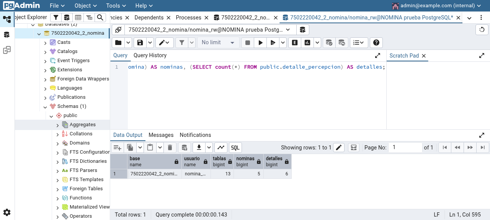

**Oracle — SQL Developer 24.3.1**
1. Cliente oficial de Oracle, instalado en la máquina.
2. Conexión: host `localhost`, puerto `1521`, servicio `NOMINAPDB`, usuario `"7502220042_2_nomina"`.
3. Verificación: `SELECT COUNT(*) FROM user_tables;` → 13 tablas.

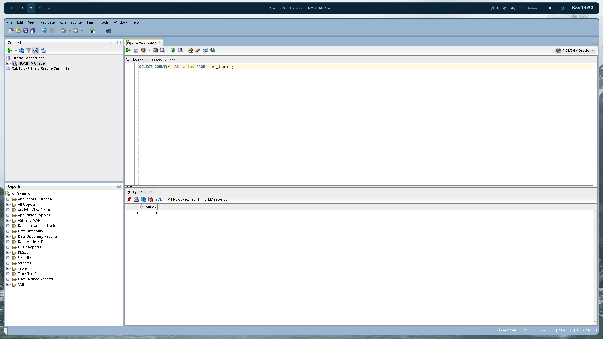

**SQL Server — Azure Data Studio 1.52.0**
1. SSMS no está disponible para Linux; se usó Azure Data Studio, el cliente GUI de Microsoft para Linux.
2. Conexión: `127.0.0.1,1433`, base `7502220042_2_nomina`, usuario `sa`.
3. Verificación: `SELECT COUNT(*) FROM sys.tables;` → 13 tablas.

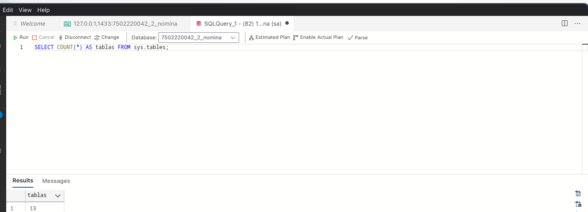

### Punto 2. Restauración de la base

**Descripción de pasos:** se restauró cada respaldo en su motor, sobre una copia aislada, y se verificó el catálogo.

**PostgreSQL**
1. Respaldo: `backup_7502220042_2_nomina.dump`, formato custom de PostgreSQL.
2. Restauración con `pg_restore --single-transaction --no-owner --no-privileges` sobre la base de prueba (creada como `nomina_u3_pruebas` y renombrada después a `7502220042_2_nomina`).
3. Resultado: 13 tablas, 13 PK y 12 FK; el respaldo no traía filas.

**SQL Server**
1. Respaldo: `BACKUP_7502220042_2_nomina_SQLServer.bak` (versión 998).
2. SQL Server 2022 no podía restaurarlo; se instaló SQL Server 2025 y se ejecutó `RESTORE DATABASE`.
3. Resultado: base `7502220042_2_nomina` con 13 tablas en `dbo`.

**Oracle**
1. Respaldo: `BACKUP_7502220042_2_NOMINA.DMP`.
2. Se creó el PDB `NOMINAPDB`, se actualizó a TSTZ 45 y se usó `_datapump_bypass_tstz_check=TRUE` para superar `ORA-39405`.
3. Se creó el tablespace `USERS`, el usuario `"7502220042_2_nomina"` y se importó con `impdp`. El único error fue `ORA-31684` porque el usuario ya existía; no afectó las tablas.
4. Resultado: 13 tablas, 0 filas.

**Evidencia:** volcados de catálogo `postgresql-tablas.txt`, `sqlserver-tablas.txt` y `oracle-tablas.txt`, incluidos en el repositorio.

### Punto 3. Verificación de tablas

**Descripción de pasos:** se consultó el catálogo de cada motor para comprobar que existían las 13 tablas del modelo.

| Motor | Consulta | Resultado |
|---|---|---:|
| PostgreSQL | `SELECT count(*) FROM information_schema.tables WHERE table_schema='public' AND table_type='BASE TABLE';` | 13 |
| SQL Server | `SELECT COUNT(*) FROM sys.tables;` | 13 |
| Oracle | `SELECT COUNT(*) FROM user_tables;` | 13 |

Las 13 tablas son: `cargo`, `categoria`, `complemento`, `contrato`, `deduccion`, `detalle_deduccion`, `detalle_percepcion`, `empleado`, `nomina`, `ocupacion_cargo`, `puesto`, `puesto_complemento` y `tramo_deduccion`.

**Evidencia:** volcados de catálogo `postgresql-tablas.txt`, `sqlserver-tablas.txt` y `oracle-tablas.txt`, incluidos en el repositorio. Las capturas del punto 1 muestran el resultado 13 en Oracle y SQL Server; la de pgAdmin muestra las 13 tablas en el árbol.

### Punto 4. Modelo relacional

**Descripción de pasos:** Regenerar el modelo con el cliente de cada motor y comparar estructura y relaciones.

**Desarrollo:** el modelo original ya está disponible. El DER de la Actividad 1 (13 entidades) y el modelo relacional de la Actividad 2 coinciden con las 13 tablas, 12 FK y cardinalidades de las tres copias restauradas. El cotejo se realizó contra las tres copias restauradas.

**Diferencia observada:** dos políticas `ON DELETE` no coinciden entre motores. En `ocupacion_cargo.dni_empleado`, PostgreSQL usa `CASCADE` y Oracle/SQL Server `NO ACTION`; en `puesto_complemento.id_complemento`, PostgreSQL usa `RESTRICT` y Oracle/SQL Server `CASCADE`. Las relaciones existen en los tres motores; se documenta la diferencia y no se modificó ninguna copia.

- PostgreSQL: pgAdmin → **ERD Tool** (`Object → ERD For Database`). **Generado y capturado** con las 13 tablas.
- Oracle: SQL Developer → **Data Modeler** (`File → Data Modeler → Import → Data Dictionary`). **Generado y capturado** con las 13 tablas.
- SQL Server: DBeaver Community → **ER Diagram**. **Generado y capturado** con las 13 tablas. SSMS no existe para Linux; DBeaver es la alternativa usada también en la Actividad 2.

#### PostgreSQL

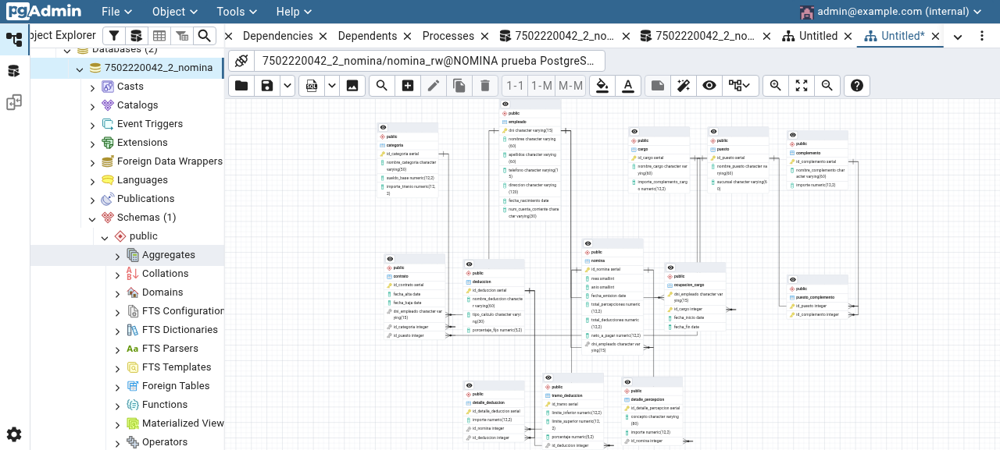

#### Oracle

Generado con **SQL Developer Data Modeler** mediante la importación del diccionario de datos del esquema `7502220042_2_nomina`. Muestra las 13 tablas, sus columnas, claves y relaciones.

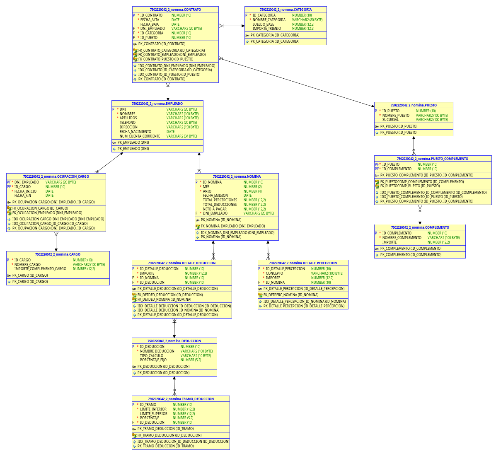

#### SQL Server

Generado con **DBeaver Community** (ER Diagram) sobre las 13 tablas del esquema `dbo`. SSMS no está disponible para Linux; DBeaver es la alternativa usada en la Actividad 2.

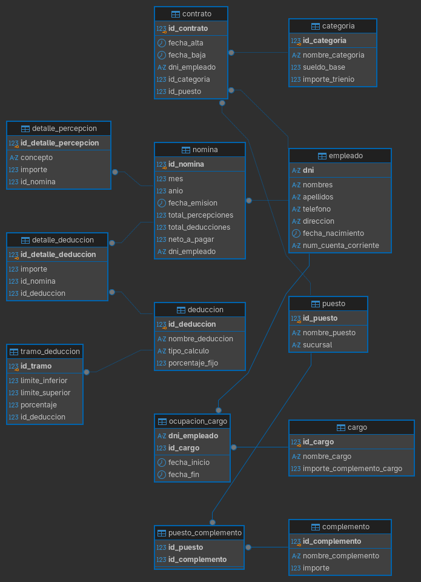

### Punto 5. Usuario `usuario_xyz`

**Descripción de pasos:** Volver a crear el usuario con las mismas credenciales de la Actividad 2.

**Desarrollo:** el usuario es `7502220042_darias`. Las contraseñas están documentadas en las capturas de la Actividad 2 (PostgreSQL p. 6; Oracle p. 5; SQL Server p. 5) y no se transcriben en el proyecto.

En las tres sentencias de creación que siguen la contraseña se escribe como `<contraseña>`: es un marcador, no la clave real. Las capturas muestran la conexión abierta con el usuario creado y la base de trabajo, no la sentencia de creación.

**Ejecutado el 14/11/2026 en las tres copias, con reconexión real:** PostgreSQL (login y 13 tablas de NOMINA visibles), SQL Server (login + `db_owner`; se remapeó un usuario huérfano del `.bak` por SID distinto) y Oracle (usuario `OPEN` con `DBA`). El usuario se recreó el 15/11/2026 tras reconstruir la copia de prueba. Evidencia: archivo `punto-05-usuarios-creados.txt`, incluido en el repositorio.

#### PostgreSQL

Sentencia de creación ejecutada:

```sql
CREATE USER "7502220042_darias" WITH PASSWORD '<contraseña>';
GRANT CONNECT ON DATABASE "7502220042_2_nomina" TO "7502220042_darias";
GRANT USAGE ON SCHEMA public TO "7502220042_darias";
GRANT SELECT, INSERT, UPDATE, DELETE ON ALL TABLES IN SCHEMA public TO "7502220042_darias";
```

**Verificación:** la base concede `CONNECT` al rol, el esquema `public` concede `USAGE` y el rol tiene 52 privilegios DML (cuatro por cada una de las 13 tablas).

La captura muestra el servidor `NOMINA actividad` registrado en pgAdmin 4 y una sesión abierta sobre la base `7502220042_2_nomina` con el usuario `7502220042_darias`. La consulta `SELECT current_user, current_database();` devuelve `7502220042_darias` y `7502220042_2_nomina`: no es una sesión con el usuario administrador ni sobre otra base, sino la conexión real a la copia de prueba con el usuario creado para la actividad.

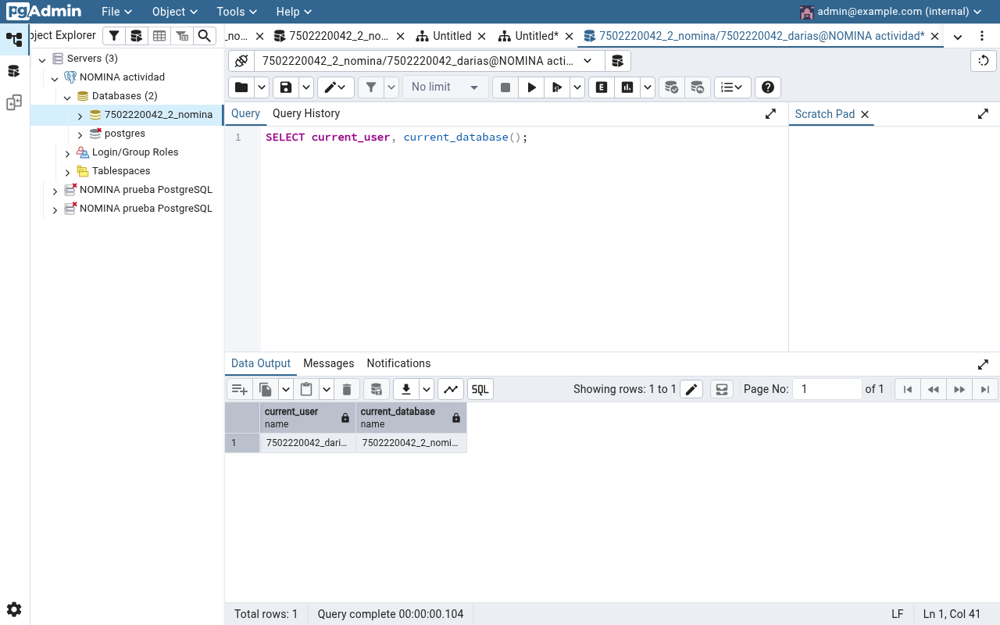

#### Oracle

Sentencia de creación ejecutada:

```sql
CREATE USER "7502220042_darias" IDENTIFIED BY "<contraseña>"
  DEFAULT TABLESPACE USERS QUOTA UNLIMITED ON USERS;
GRANT CREATE SESSION, DBA TO "7502220042_darias";
```

La captura corresponde a SQL Developer con la conexión `NOMINA actividad Oracle` abierta. En la hoja de trabajo se ejecutó:

```sql
SELECT USER AS usuario,
       SYS_CONTEXT('USERENV', 'CON_NAME') AS pdb
FROM dual;
```

**Resultado obtenido:** una fila, con `USUARIO = 7502220042_darias` y `PDB = NOMINAPDB`.

La consulta devuelve el usuario de la sesión y el contenedor donde se abrió. El usuario es el creado para la actividad y el contenedor es el PDB de trabajo, no `CDB$ROOT`: la sesión no quedó abierta con una cuenta de administración ni sobre el contenedor raíz.

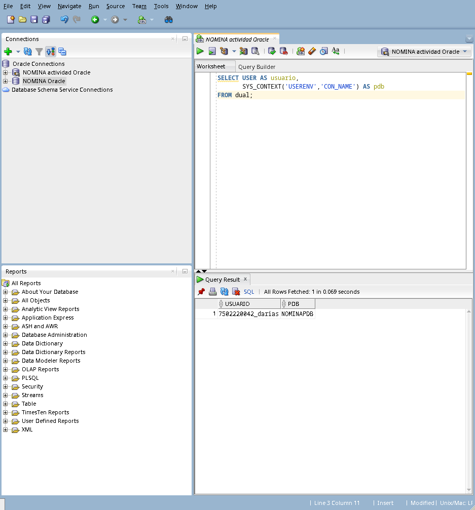

#### SQL Server

<p style="page-break-after: avoid;"><strong>Sentencia de creación ejecutada:</strong></p>

```sql
CREATE LOGIN [7502220042_darias] WITH PASSWORD = N'<contraseña>',
    DEFAULT_DATABASE = [7502220042_2_nomina];

USE [7502220042_2_nomina];
CREATE USER [7502220042_darias] FOR LOGIN [7502220042_darias];
ALTER ROLE db_owner ADD MEMBER [7502220042_darias];
```

El `.bak` traía un usuario con otro SID; cuando el login ya existía se remapeó el usuario de la base con `ALTER USER [7502220042_darias] WITH LOGIN = [7502220042_darias];`, porque sin ese paso la conexión fallaba con error 38.

La captura corresponde a Azure Data Studio con la conexión `NOMINA actividad SQL Server` y la base `7502220042_2_nomina` seleccionada. En la hoja de trabajo se ejecutó:

```sql
SELECT SUSER_SNAME() AS usuario, DB_NAME() AS base;
```

**Resultado obtenido:** una fila, con `usuario = 7502220042_darias` y `base = 7502220042_2_nomina`.

La consulta devuelve el login de la sesión y la base activa. El login es el creado para la actividad y la base es la copia de prueba: la sesión no quedó abierta con `sa` ni sobre otra base. La contraseña no se transcribe.


### Punto 6. Reconexión con `usuario_xyz`

**Descripción de pasos:** Desconectar y volver a conectar con esas credenciales.

**Desarrollo:** reconexión verificada en el cliente en los tres motores (`reconexion=7502220042_darias@…`); las capturas de PostgreSQL, Oracle y SQL Server muestran el cliente después de reconectar.

#### PostgreSQL

Se cerró la sesión abierta sobre el servidor `NOMINA actividad` y se volvió a conectar con las mismas credenciales. Tras la reconexión se ejecutó:

```sql
SELECT current_user, current_database();
```

**Resultado obtenido:** `7502220042_darias` y `7502220042_2_nomina`.

El resultado confirma que la segunda conexión no fue con el usuario administrador ni sobre otra base: la sesión reconectada quedó como `7502220042_darias` sobre la base `7502220042_2_nomina`, la copia de prueba.

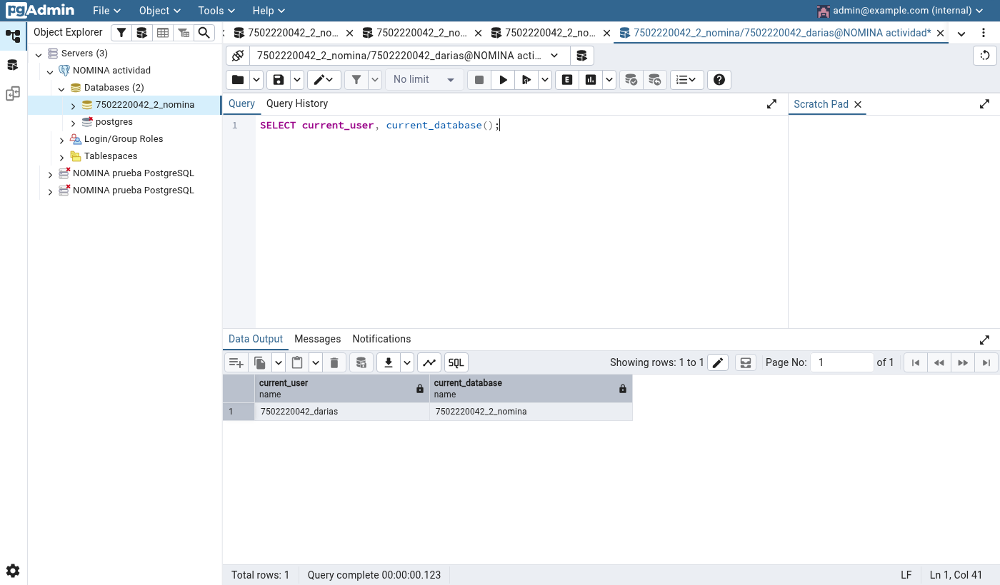

#### Oracle

Se cerró la conexión `NOMINA actividad Oracle` y se abrió de nuevo con las mismas credenciales. La primera captura muestra la hoja de trabajo sin resultado y el árbol de objetos sin desplegar: no hay sesión activa sobre esa conexión.

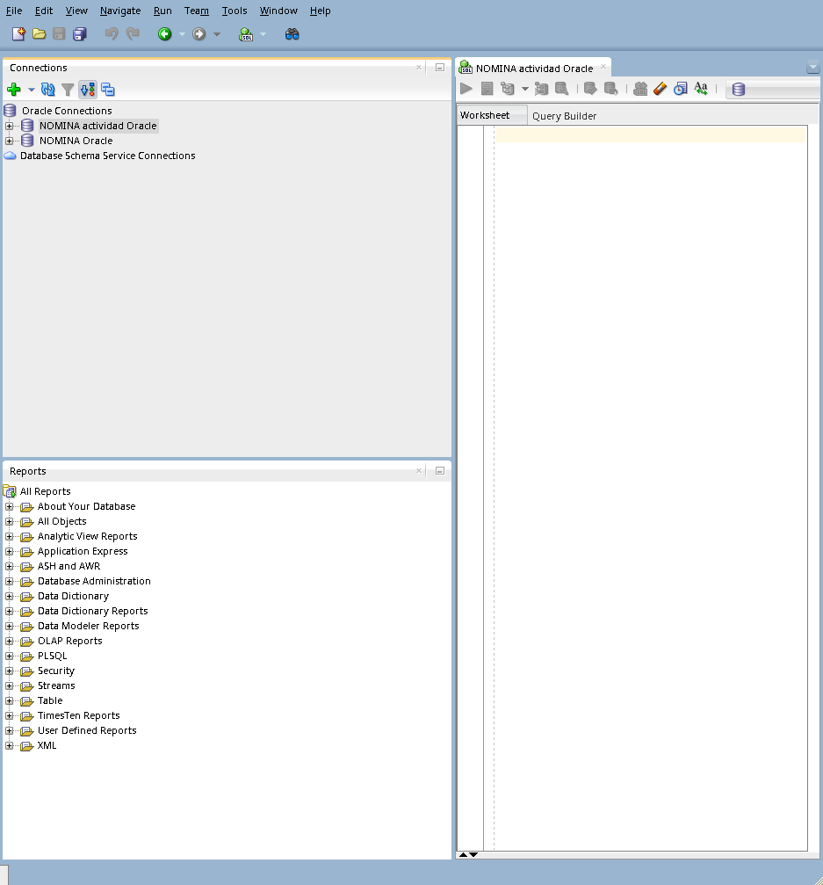

La segunda captura corresponde a la sesión ya reconectada. Se ejecutó `SELECT USER FROM dual;` y el valor devuelto fue `7502220042_darias`; además, el árbol de la conexión aparece desplegado con las categorías de objetos de la base.

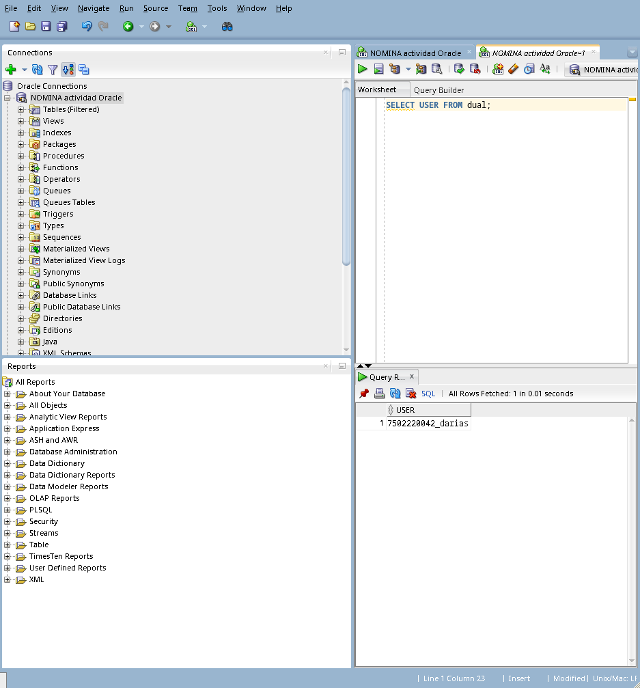

#### SQL Server

Se cerró la sesión de la conexión `NOMINA actividad SQL Server` en Azure Data Studio. La primera captura muestra esa conexión desconectada en el panel de conexiones: el nodo queda cerrado y sin desplegar los objetos de la base.

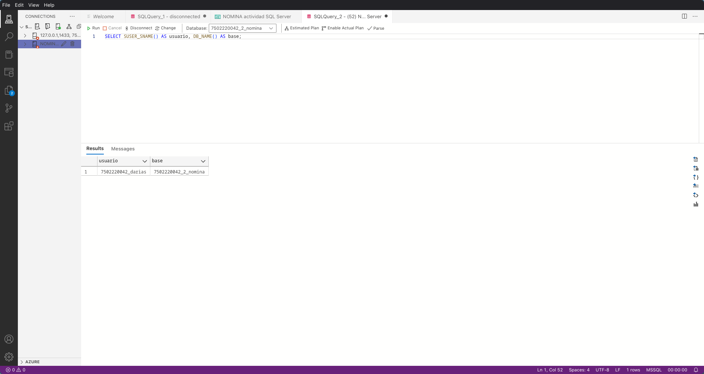

La segunda captura corresponde a la conexión ya reabierta con las mismas credenciales: el nodo aparece desplegado con los objetos de la base `7502220042_2_nomina` y, sobre esa sesión, se ejecutó de nuevo:

```sql
SELECT SUSER_SNAME() AS usuario, DB_NAME() AS base;
```

**Resultado obtenido:** `7502220042_darias` y `7502220042_2_nomina`.

El resultado confirma que la segunda conexión no fue con `sa` ni sobre otra base: la sesión reconectada quedó como `7502220042_darias` sobre `7502220042_2_nomina`, la copia de prueba.

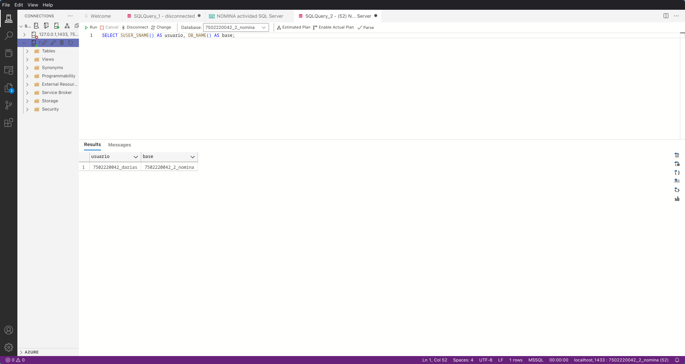

<div style="page-break-before: always;"></div>

### Punto 7. Bases de datos del usuario

**Descripción de pasos:** Mostrar las bases de datos de `usuario_xyz`.

**Desarrollo:** consulta de catálogo ejecutada y capturada en los tres motores. En Oracle el equivalente se expresa como PDB y esquema, porque no existen “bases” separadas como en PostgreSQL o SQL Server.

#### PostgreSQL

Consulta ejecutada:

```sql
SELECT datname
FROM pg_database
WHERE has_database_privilege(current_user, datname, 'CONNECT')
ORDER BY 1;
```

**Resultado obtenido:** 4 bases de datos.

| # | Base de datos |
|---:|---|
| 1 | `7502220042_2_nomina` |
| 2 | `postgres` |
| 3 | `template0` |
| 4 | `template1` |

La primera es la base de la copia de prueba, donde está la tabla NOMINA; las otras tres son las bases del sistema que la instalación deja accesibles. La consulta filtra por `has_database_privilege(..., 'CONNECT')`, así que solo aparecen las bases a las que el usuario puede conectarse.

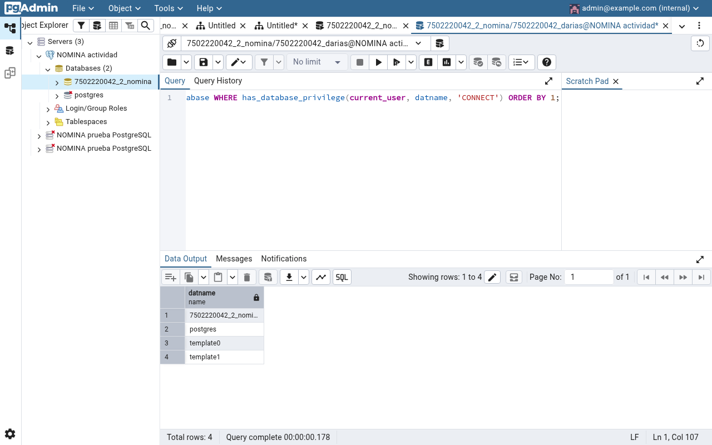

La captura corresponde a pgAdmin 4 con la conexión `7502220042_2_nomina/7502220042_darias@NOMINA actividad`; el resultado tiene 4 filas.

#### Oracle

En Oracle un usuario no tiene un conjunto de bases propias como en PostgreSQL o SQL Server: los objetos viven en esquemas dentro de un PDB. El equivalente práctico de “bases de datos del usuario” son dos datos: el PDB donde se abrió la sesión y el esquema cuyas tablas el usuario puede consultar.

Consulta ejecutada:

```sql
SELECT 'PDB' AS dato, SYS_CONTEXT('USERENV','CON_NAME') AS valor FROM dual
UNION ALL
SELECT 'TABLAS_NOMINA', TO_CHAR(COUNT(*)) FROM all_tables WHERE owner='7502220042_2_nomina';
```

**Resultado obtenido:**

| DATO | VALOR |
|---|---|
| `PDB` | `NOMINAPDB` |
| `TABLAS_NOMINA` | `13` |

La primera fila indica que la sesión está en el PDB `NOMINAPDB`. La segunda cuenta en el diccionario las tablas del esquema `7502220042_2_nomina`, donde están los objetos de la copia de prueba: son 13, el mismo número de tablas verificado en el punto 3. `all_tables` solo muestra las tablas a las que el usuario tiene acceso, así que el resultado también confirma que la sesión alcanza ese esquema.

La captura muestra la hoja de trabajo de SQL Developer y, en `Query Result`, las dos filas con los valores anteriores.

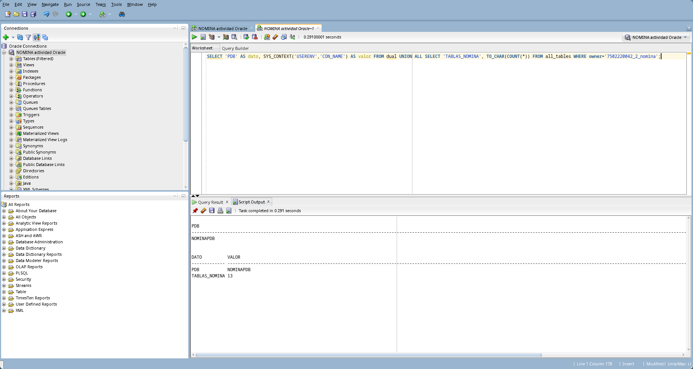

#### SQL Server

Consulta ejecutada:

```sql
SELECT name AS base
FROM sys.databases
WHERE HAS_DBACCESS(name) = 1
ORDER BY name;
```

**Resultado obtenido:** 4 bases de datos.

| # | Base de datos |
|---:|---|
| 1 | `7502220042_2_nomina` |
| 2 | `master` |
| 3 | `msdb` |
| 4 | `tempdb` |

La primera es la base de la copia de prueba, donde está la tabla NOMINA; las otras tres son las bases del sistema que la instalación deja accesibles. La consulta filtra con `HAS_DBACCESS(name) = 1`, así que solo aparecen las bases a las que el usuario puede conectarse.

La captura corresponde a Azure Data Studio con la conexión `NOMINA actividad SQL Server` sobre la base `7502220042_2_nomina`; el resultado tiene 4 filas.

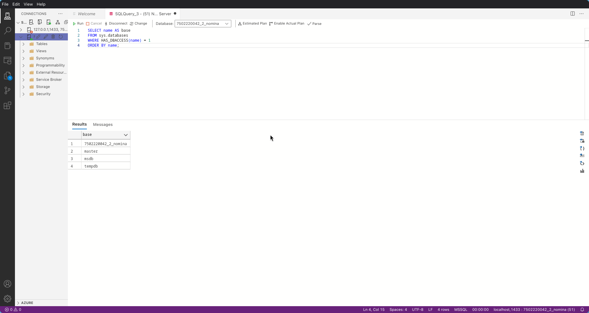

### Punto 8. IDE(s)

**Descripción de pasos:** Instalar al menos tres IDE y conectarlos a los tres motores usados, con una conexión por IDE (tres en total).

**Desarrollo:** se usan tres IDE de la lista de la guía, uno por motor:

| IDE | Versión | Motor asignado | Conector |
|---|---|---|---|
| NetBeans | 30-1 | PostgreSQL | `postgresql-42.5.4.jar`, incluido en el IDE |
| Visual Studio Code | 1.131.0 | SQL Server | Extensión oficial `ms-mssql.mssql` |
| IntelliJ IDEA Community | 2026.3 | Oracle | Plugin *Database Navigator* + `ojdbc11.jar` |

Cada IDE abre una conexión al motor que le corresponde con el usuario `7502220042_darias`, de modo que las tres conexiones cubren los tres motores. DBeaver no se usa en este punto: es un cliente de base de datos, no un IDE.

#### NetBeans → PostgreSQL

NetBeans incluye el controlador de PostgreSQL (`ide/modules/ext/postgresql-42.5.4.jar`), así que no requiere descargas adicionales. Se registró la conexión `jdbc:postgresql://127.0.0.1:55432/7502220042_2_nomina` con el usuario `7502220042_darias` y se ejecutó la consulta de verificación en el editor SQL del IDE.

**Resultado obtenido:** `tablas = 13`, con el mensaje «Execution finished after 0.116 s, no errors occurred».

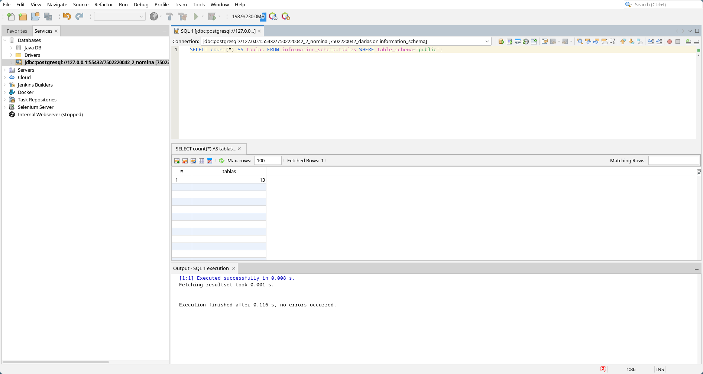

#### Visual Studio Code → SQL Server

Se instaló la extensión oficial *SQL Server (mssql)* de Microsoft, que aporta el controlador del motor. La conexión `NOMINA SQL Server` apunta a `localhost,1433` con autenticación SQL y el usuario `7502220042_darias`; la base `7502220042_2_nomina` queda seleccionada en la barra de estado.

**Resultado obtenido:** `usuario = 7502220042_darias`, `base = 7502220042_2_nomina`.

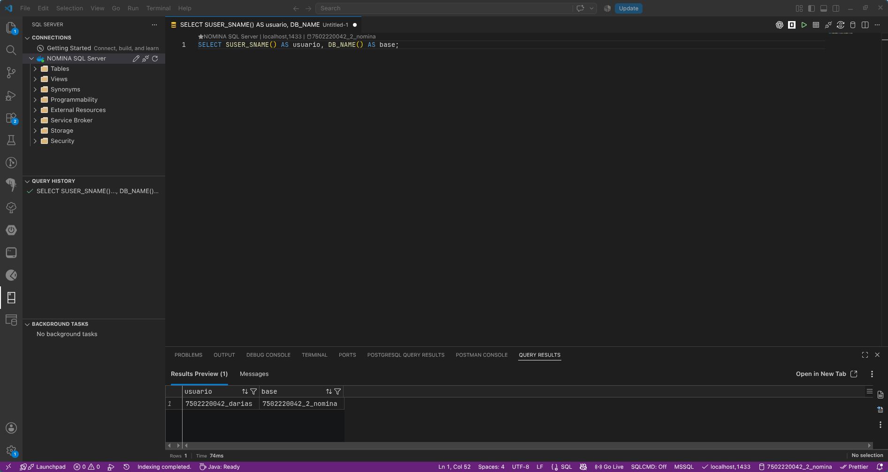

#### IntelliJ IDEA Community → Oracle

IntelliJ Community no incluye las herramientas de base de datos de Ultimate; se usa el plugin *Database Navigator* con el controlador JDBC `ojdbc11.jar`, tomado de la instalación de SQL Developer.

**Captura:** `[CAPTURA PENDIENTE: punto 8 — IntelliJ/Oracle]`

<div style="page-break-before: always;"></div>

## Segunda parte (70 %)

Formato por ejercicio: **A)** texto SQL, **B)** explicación, **C)** recorte de pantalla del editor y resultado. **Alcance:** la primera parte se documenta en los tres motores; la segunda parte se resuelve en uno de ellos. Las capturas 1–69 están hechas con un cliente GUI web. Los 69 ejercicios están ejecutados y capturados.

**Nota de orden de ejecución:** el orden real no fue 1→69. Los ejercicios 58–65 se ejecutaron antes que 40–57 y algunas consultas de solo lectura se repitieron al final; por eso la barra lateral de algunas capturas puede mostrar `TablaY` o valores del estado final. Los `UPDATE` conservan su `RETURNING *` con la fila modificada.

### Ejercicio 1. Insertar en TablaZ al menos un registro usando la forma de inserción completa de SQL

**A. Instrucción SQL:**

```sql
INSERT INTO public.detalle_percepcion
    (id_detalle_percepcion, concepto, importe, id_nomina)
VALUES
    (1, 'Beca académica', 250.00, 1);
```

**B. Explicación:** Inserta una fila en la tabla hija con todas sus columnas. id_nomina = 1 referencia la nómina creada en el ejercicio 3; sin ese padre la FK fallaría. Por eso el padre se creó primero: el orden de ejecución fue 3→1.

**Resultado obtenido:** INSERT 0 1. Fila id_detalle_percepcion = 1, concepto 'Beca académica', importe 250.00, id_nomina 1.

**Verificación posterior:**

```sql
SELECT id_detalle_percepcion, concepto, importe, id_nomina
FROM public.detalle_percepcion
WHERE id_detalle_percepcion = 1;
```

**C. Captura:** 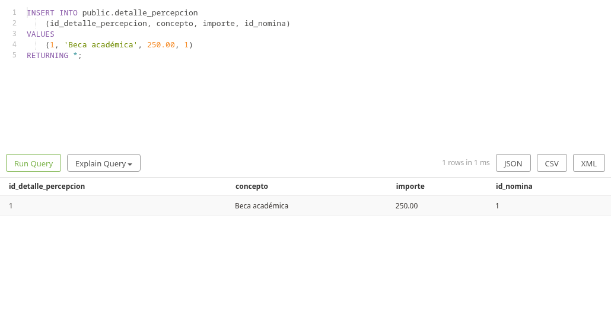

La captura añade `RETURNING *` para mostrar la fila insertada; la instrucción base es el INSERT.

### Ejercicio 2. Mostrar todos los registros insertados en TablaZ

**A. Instrucción SQL:**

```sql
SELECT id_detalle_percepcion, concepto, importe, id_nomina
FROM public.detalle_percepcion
ORDER BY id_detalle_percepcion;
```

**B. Explicación:** Muestra todas las filas de detalle_percepcion. En el punto de ejecución solo existía la fila del ejercicio 1.

**Resultado obtenido:** 1 fila: Beca académica, 250.00, id_nomina 1.

**Verificación posterior:**

```sql
La propia consulta es la verificación; al final de la serie devolvería 6 filas.
```

**C. Captura:** 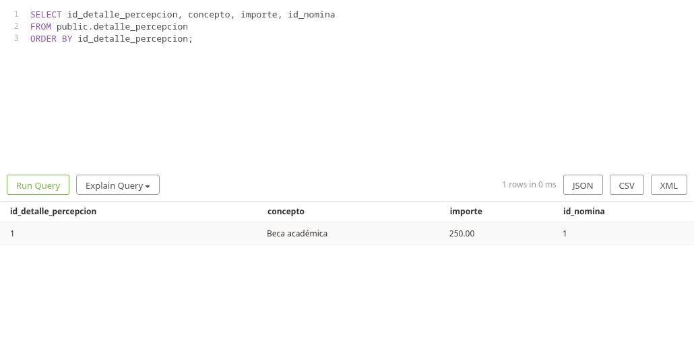

### Ejercicio 3. Insertar en TablaX al menos 5 registros usando el formato de inserción completo de SQL

**A. Instrucción SQL:**

```sql
INSERT INTO public.nomina
    (id_nomina, mes, anio, fecha_emision,
     total_percepciones, total_deducciones, neto_a_pagar, dni_empleado)
VALUES
    (1, 1, 2024, DATE '2024-01-31', 1000.00, 100.00,  900.00, NULL),
    (2, 2, 2024, DATE '2024-02-29', 1100.00, 110.00,  990.00, NULL),
    (3, 3, 2024, DATE '2024-03-31', 1200.00, 120.00, 1080.00, NULL),
    (4, 4, 2024, DATE '2024-04-30', 1300.00, 130.00, 1170.00, NULL),
    (5, 5, 2024, DATE '2024-05-31', 1400.00, 140.00, 1260.00, NULL);
```

**B. Explicación:** Inserta cinco nóminas con las ocho columnas. dni_empleado = NULL es válido porque la FK lo permite y la tabla empleado está vacía; no se inventó un empleado.

**Resultado obtenido:** INSERT 0 5. Cinco filas con ids 1–5 y fechas/montos indicados.

**Verificación posterior:**

```sql
SELECT id_nomina, mes, anio, fecha_emision,
       total_percepciones, total_deducciones, neto_a_pagar, dni_empleado
FROM public.nomina
WHERE id_nomina BETWEEN 1 AND 5
ORDER BY id_nomina;
```

**C. Captura:** 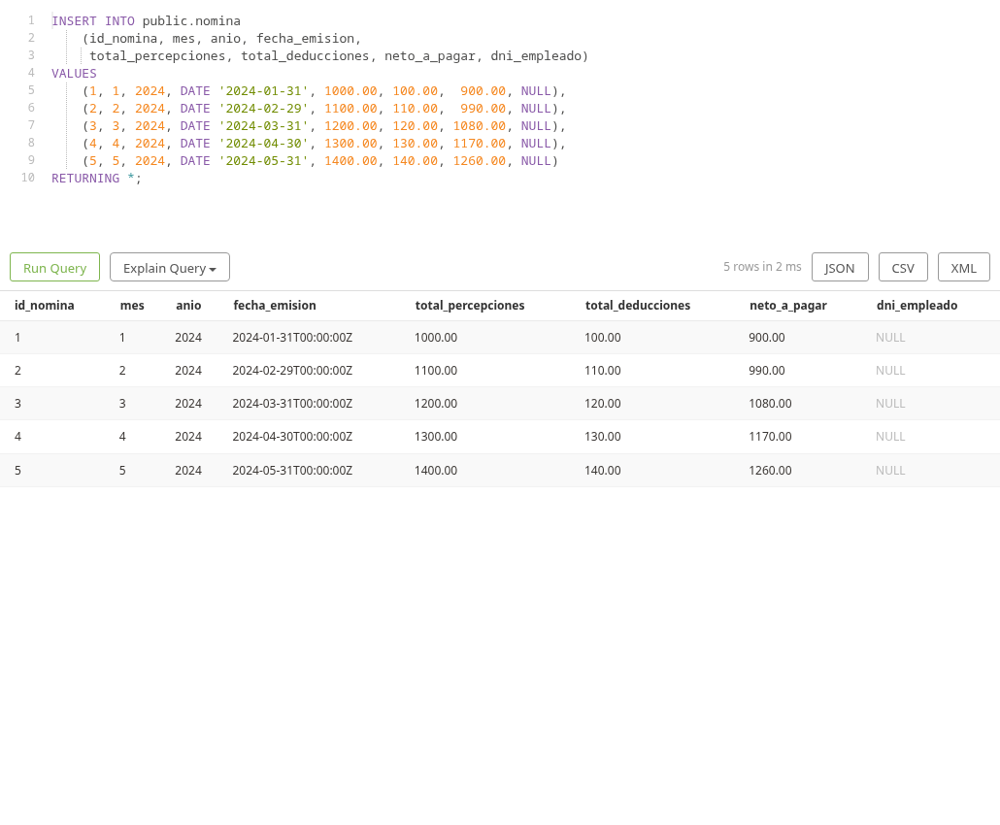

La captura añade `RETURNING *` para mostrar las cinco filas insertadas; la instrucción base es el INSERT múltiple.

### Ejercicio 4. Mostrar todos los registros insertados en TablaX

**A. Instrucción SQL:**

```sql
SELECT id_nomina, mes, anio, fecha_emision,
       total_percepciones, total_deducciones, neto_a_pagar, dni_empleado
FROM public.nomina
ORDER BY id_nomina;
```

**B. Explicación:** Muestra las cinco nóminas insertadas, ordenadas por PK.

**Resultado obtenido:** 5 filas, ids 1–5.

**Verificación posterior:**

```sql
La propia consulta es la verificación.
```

**C. Captura:** 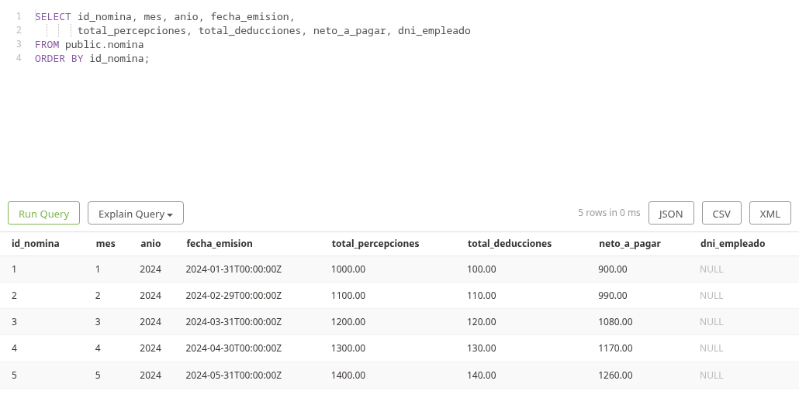

### Ejercicio 5. Insertar en TablaZ al menos 5 registros usando el formato de inserción parcial, relacionados con los registros insertados previamente en TablaX

**A. Instrucción SQL:**

```sql
INSERT INTO public.detalle_percepcion
    (concepto, importe, id_nomina)
VALUES
    ('Bono de transporte',    120.00, 1),
    ('Bono de alimentación',  180.00, 2),
    ('Apoyo de materiales',    90.00, 3),
    ('Bonificación académica', 300.00, 4),
    ('Subsidio de estudio',   150.00, 5);
```

**B. Explicación:** Inserción parcial: omite id_detalle_percepcion para usar el default de secuencia e incluye las tres columnas restantes. Cada id_nomina referencia una nómina del ejercicio 3.

**Resultado obtenido:** INSERT 0 5. Filas nuevas con ids 2–6, enlazadas a nóminas 1–5.

**Verificación posterior:**

```sql
SELECT id_detalle_percepcion, concepto, importe, id_nomina
FROM public.detalle_percepcion
WHERE id_detalle_percepcion BETWEEN 2 AND 6
ORDER BY id_detalle_percepcion;
```

**C. Captura:** 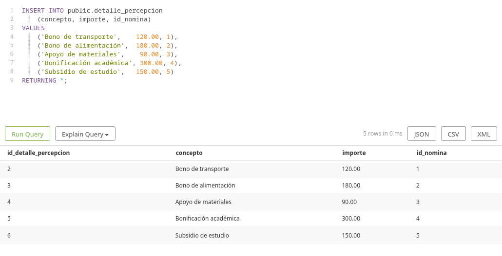

La captura añade `RETURNING *` para mostrar las cinco filas insertadas; la instrucción base es el INSERT parcial.

### Ejercicio 6. Mostrar todos los registros insertados en TablaX y los insertados en TablaZ; usar instrucciones SQL separadas para cada consulta

**A. Instrucción SQL (consulta 1, TablaX = `nomina`):**

```sql
SELECT id_nomina, mes, anio, fecha_emision,
       total_percepciones, total_deducciones,
       neto_a_pagar, dni_empleado
FROM public.nomina
ORDER BY id_nomina;
```

**A. Instrucción SQL (consulta 2, TablaZ = `detalle_percepcion`):**

```sql
SELECT id_detalle_percepcion, concepto,
       importe, id_nomina
FROM public.detalle_percepcion
ORDER BY id_detalle_percepcion;
```

**B. Explicación:** se usan dos consultas independientes, como pide el enunciado. La primera muestra las cinco nóminas insertadas en el ejercicio 3; la segunda, los seis detalles insertados en los ejercicios 1 y 5. No se unen en una sola consulta porque el punto exige instrucciones separadas.

**Resultado obtenido:** 5 filas en `nomina` (ids 1–5) y 6 filas en `detalle_percepcion` (ids 1–6).

**C. Captura (consulta 1):** 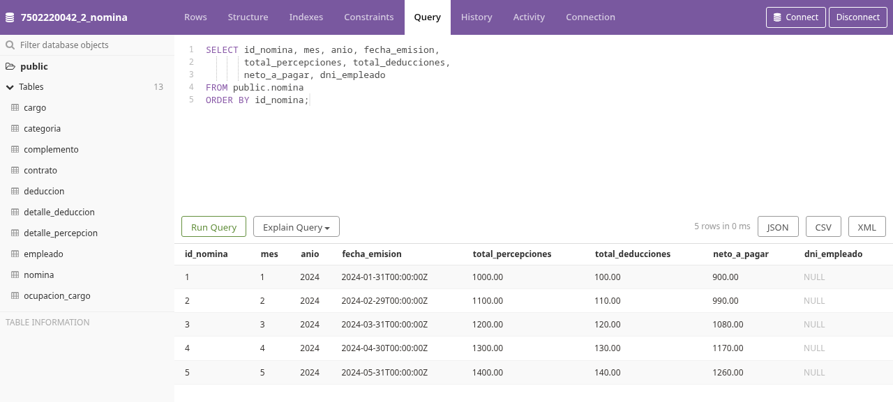

**C. Captura (consulta 2):** 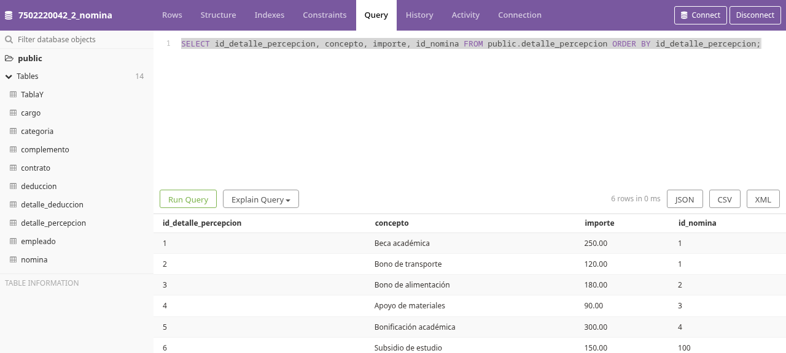

Las capturas son de un cliente GUI web contra `7502220042_2_nomina`; no se editó el resultado.

### Ejercicio 7. Insertar en TablaX al menos 15 registros usando el formato de inserción múltiple de SQL

**A. Instrucción SQL:**

```sql
INSERT INTO public.nomina
    (id_nomina, mes, anio, fecha_emision,
     total_percepciones, total_deducciones,
     neto_a_pagar, dni_empleado)
VALUES
    (21, 6, 2024, DATE '2024-06-30', 1500, 150, 1350, NULL),
    (22, 7, 2024, DATE '2024-07-31', 1600, 160, 1440, NULL),
    (23, 8, 2024, DATE '2024-08-31', 1700, 170, 1530, NULL),
    (24, 9, 2024, DATE '2024-09-30', 1800, 180, 1620, NULL),
    (25, 10, 2024, DATE '2024-10-31', 1900, 190, 1710, NULL),
    (26, 11, 2024, DATE '2024-11-30', 2000, 200, 1800, NULL),
    (27, 12, 2024, DATE '2024-12-31', 2100, 210, 1890, NULL),
    (28, 1, 2025, DATE '2025-01-31', 2200, 220, 1980, NULL),
    (29, 2, 2025, DATE '2025-02-28', 2300, 230, 2070, NULL),
    (30, 3, 2025, DATE '2025-03-31', 2400, 240, 2160, NULL),
    (31, 4, 2025, DATE '2025-04-30', 2500, 250, 2250, NULL),
    (32, 5, 2025, DATE '2025-05-31', 2600, 260, 2340, NULL),
    (33, 6, 2025, DATE '2025-06-30', 2700, 270, 2430, NULL),
    (34, 7, 2025, DATE '2025-07-31', 2800, 280, 2520, NULL),
    (35, 8, 2025, DATE '2025-08-31', 2900, 290, 2610, NULL)
RETURNING *;
```

**B. Explicación:** Inserta quince nóminas de prueba (ids 21–35) con el formato de inserción múltiple. Los meses cubren junio–diciembre de 2024 y enero–agosto de 2025; `dni_empleado` queda NULL porque la tabla `empleado` está vacía.

**Resultado obtenido:** 15 filas insertadas, ids 21–35. La captura añade `RETURNING *` para mostrar las filas insertadas.

**C. Captura:** 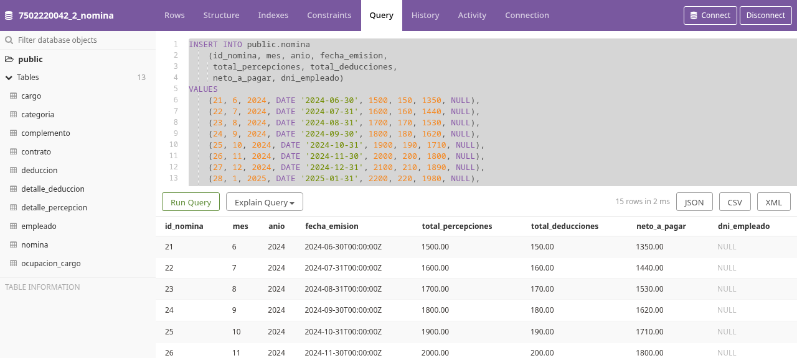

### Ejercicio 8. Mostrar el contenido completo de TablaX

**A. Instrucción SQL:**

```sql
SELECT * FROM public.nomina ORDER BY id_nomina;
```

**B. Explicación:** Muestra todas las filas de `nomina` ordenadas por PK. En este punto hay 20: las 5 iniciales y las 15 del ejercicio 7.

**Resultado obtenido:** 20 filas.

**C. Captura:** 

### Ejercicio 9. Insertar al menos un registro en TablaX usando la forma completa, pero omitir en la lista de valores el valor de al menos una columna

**A. Instrucción SQL:**

```sql
INSERT INTO public.nomina
    (id_nomina, mes, anio, fecha_emision,
     total_percepciones, total_deducciones,
     neto_a_pagar, dni_empleado)
VALUES
    (36, 9, 2025, DATE '2025-09-30',
     3000.00, 300.00, 2700.00);
```

**B. Explicación:** Se listan las ocho columnas y se entregan solo siete valores: la columna omitida es `dni_empleado`. El desajuste entre columnas y valores debe fallar.

**Resultado obtenido:** ERROR: `INSERT has more target columns than expressions`. No se insertó ninguna fila.

**C. Captura:** 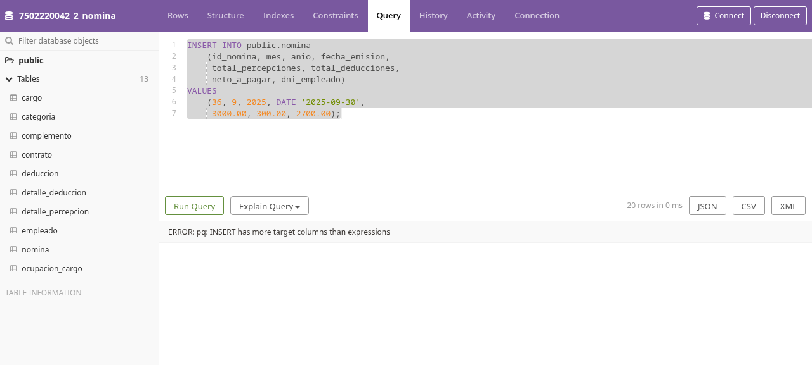

### Ejercicio 10. Mostrar el contenido completo de TablaX

**A. Instrucción SQL:**

```sql
SELECT * FROM public.nomina ORDER BY id_nomina;
```

**B. Explicación:** Vuelve a mostrar el contenido completo de `nomina`; el estado no cambió porque el ejercicio 9 falló.

**Resultado obtenido:** 20 filas.

**C. Captura:** 

### Ejercicio 11. Insertar al menos un registro en TablaX con inserción parcial, sin incluir en la lista de columnas al menos una columna cuyo valor no acepta NULL

**A. Instrucción SQL:**

```sql
INSERT INTO public.nomina
    (mes, anio, fecha_emision,
     total_percepciones, total_deducciones,
     neto_a_pagar, dni_empleado)
VALUES
    (9, 2025, DATE '2025-09-30',
     3000.00, 300.00, 2700.00, NULL)
RETURNING *;
```

**B. Explicación:** Inserción parcial: se omite `id_nomina`, que es `NOT NULL` pero tiene default de secuencia. El valor lo asigna la secuencia.

**Resultado obtenido:** 1 fila insertada con `id_nomina = 6`. **No hay violación NOT NULL**: la omisión no falla porque la columna tiene default.

**C. Captura:** 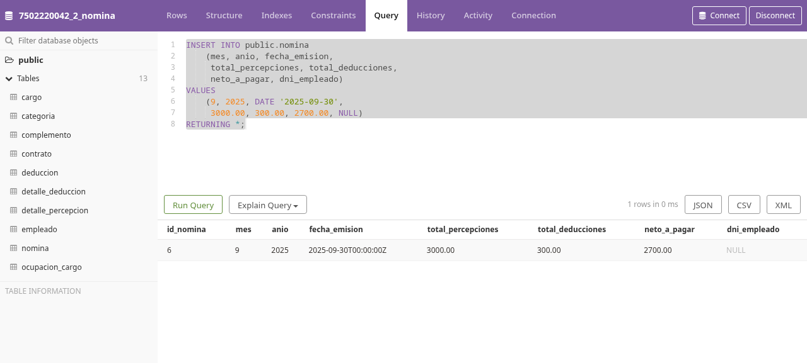

**Prueba complementaria (11b), NULL explícito:**

```sql
INSERT INTO public.nomina
    (id_nomina, mes, anio, fecha_emision,
     total_percepciones, total_deducciones,
     neto_a_pagar, dni_empleado)
VALUES
    (NULL, 10, 2025, DATE '2025-10-31',
     3100.00, 310.00, 2790.00, NULL);
```

**Resultado:** ERROR: `null value in column "id_nomina" of relation "nomina" violates not-null constraint`. La restricción sí se aplica cuando el valor es NULL explícito.

**C. Captura complementaria:** 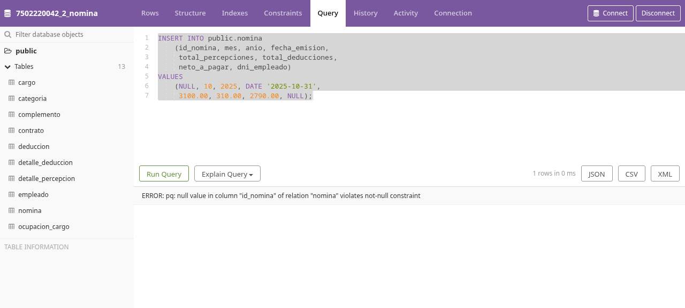

### Ejercicio 12. Mostrar el contenido completo de TablaX

**A. Instrucción SQL:**

```sql
SELECT * FROM public.nomina ORDER BY id_nomina;
```

**B. Explicación:** Muestra todas las filas de `nomina` después de la inserción parcial.

**Resultado obtenido:** 21 filas.

**C. Captura:** 

### Ejercicio 13. Insertar al menos un registro en TablaX, con cualquier forma de INSERT, cuyo valor de PK ya esté insertado en esa misma columna de esa tabla

**A. Instrucción SQL:**

```sql
INSERT INTO public.nomina
    (id_nomina, mes, anio, fecha_emision,
     total_percepciones, total_deducciones,
     neto_a_pagar, dni_empleado)
VALUES
    (1, 1, 2024, DATE '2024-01-31',
     1000.00, 100.00, 900.00, NULL);
```

**B. Explicación:** Intenta insertar una fila con `id_nomina = 1`, que ya existe. Debe violar la PK.

**Resultado obtenido:** ERROR: `duplicate key value violates unique constraint "nomina_pkey"`. No se insertó nada.

**C. Captura:** 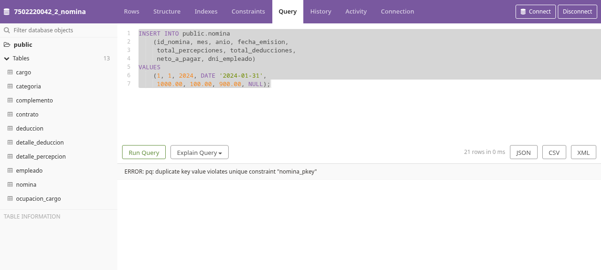

### Ejercicio 14. Mostrar el contenido completo de TablaX

**A. Instrucción SQL:**

```sql
SELECT * FROM public.nomina ORDER BY id_nomina;
```

**B. Explicación:** Muestra el contenido completo de `nomina`; sigue en 21 filas porque el ejercicio 13 falló.

**Resultado obtenido:** 21 filas.

**C. Captura:** 

### Ejercicio 15. Tomar un registro de TablaX cuya PK esté relacionada con al menos un registro de TablaZ y cambiar la PK por un valor nuevo no ingresado previamente en esa PK

**A. Instrucción SQL:**

```sql
UPDATE public.nomina
SET id_nomina = 100
WHERE id_nomina = 5
RETURNING *;
```

**B. Explicación:** Cambia la PK de la nómina 5 por 100. Esa nómina tiene el detalle 6, así que se prueba la acción `ON UPDATE CASCADE` de la FK.

**Resultado obtenido:** 1 fila afectada. El detalle 6 pasa a `id_nomina = 100`; se comprueba en el ejercicio 18.

**C. Captura:** 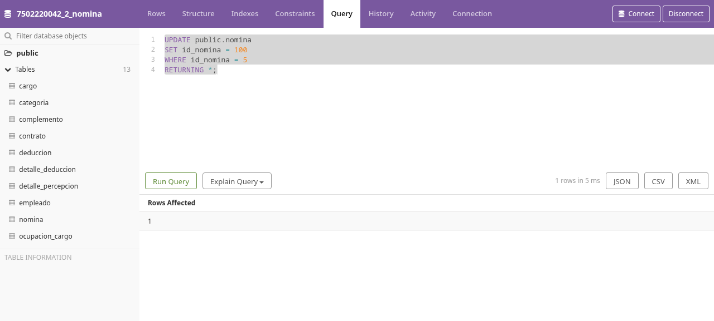

### Ejercicio 16. Mostrar el contenido completo de TablaX

**A. Instrucción SQL:**

```sql
SELECT * FROM public.nomina ORDER BY id_nomina;
```

**B. Explicación:** Muestra el contenido completo de `nomina` después del cambio de PK.

**Resultado obtenido:** 21 filas: aparece 100 y ya no 5.

**C. Captura:** 

### Ejercicio 17. En TablaZ, cambiar la FK que referencia a TablaX por un valor nuevo que no exista en la PK de TablaX

**A. Instrucción SQL:**

```sql
UPDATE public.detalle_percepcion
SET id_nomina = 999
WHERE id_detalle_percepcion = 3
RETURNING *;
```

**B. Explicación:** Asigna a la FK del detalle 3 el valor 999, que no existe en la PK de `nomina`. Debe violar la FK.

**Resultado obtenido:** ERROR: `insert or update on table "detalle_percepcion" violates foreign key constraint "fk_dpercep_nomina"`. No se modificó la fila.

**C. Captura:** 

### Ejercicio 18. Mostrar el contenido completo de TablaZ

**A. Instrucción SQL:**

```sql
SELECT * FROM public.detalle_percepcion ORDER BY id_detalle_percepcion;
```

**B. Explicación:** Muestra todos los detalles. El detalle 6 evidencia la cascada del ejercicio 15.

**Resultado obtenido:** 6 filas; el detalle 6 tiene `id_nomina = 100`.

**C. Captura:** 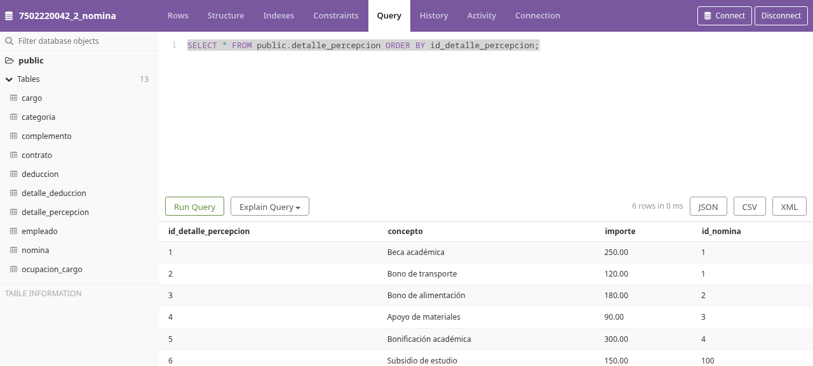

### Ejercicio 19. Mostrar el contenido completo de TablaX

**A. Instrucción SQL:**

```sql
SELECT * FROM public.nomina ORDER BY id_nomina;
```

**B. Explicación:** Muestra el contenido completo de `nomina` al cierre de la serie.

**Resultado obtenido:** 21 filas; el estado final coincide con el del ejercicio 16.

**C. Captura:** 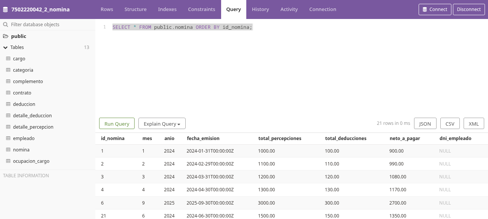

### Ejercicio 20. Seleccionar en TablaX una columna que no acepte NULL y cambiar el valor de un registro a NULL

**A. Instrucción SQL:**

```sql
UPDATE public.nomina SET id_nomina = NULL WHERE id_nomina = 21;
```

**B. Explicación:** Intenta asignar NULL a la PK, que es `NOT NULL`. Debe fallar.

**Resultado obtenido:** ERROR: `null value in column "id_nomina" of relation "nomina" violates not-null constraint`. No se modificó la fila.

**C. Captura:** 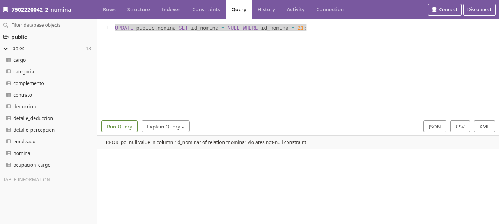

### Ejercicio 21. Mostrar el contenido completo de TablaX

**A. Instrucción SQL:**

```sql
SELECT * FROM public.nomina ORDER BY id_nomina;
```

**B. Explicación:** Muestra el contenido completo tras el intento fallido del 20.

**Resultado obtenido:** 21 filas; la fila 21 sigue con `total_percepciones = 1500.00`.

**C. Captura:** 

### Ejercicio 22. Elegir una columna numérica de TablaX y cambiar un registro ingresando un valor textual no numérico

**A. Instrucción SQL:**

```sql
UPDATE public.nomina SET total_percepciones = 'abc' WHERE id_nomina = 21;
```

**B. Explicación:** Introduce texto no numérico en una columna `numeric`. Debe fallar.

**Resultado obtenido:** ERROR: `invalid input syntax for type numeric: "abc"`. No se modificó la fila.

**C. Captura:** 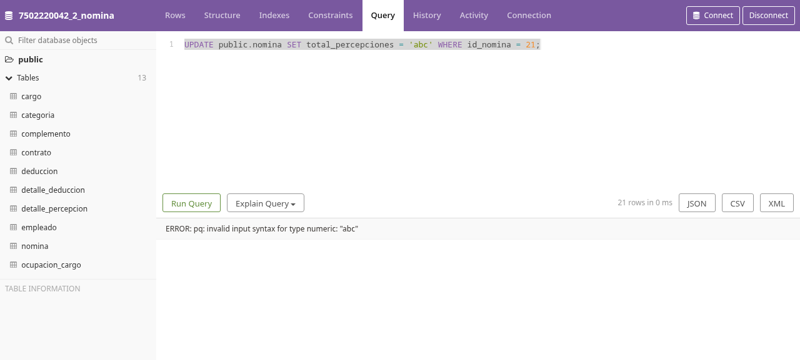

### Ejercicio 23. Mostrar el contenido completo de TablaX

**A. Instrucción SQL:**

```sql
SELECT * FROM public.nomina ORDER BY id_nomina;
```

**B. Explicación:** Muestra el contenido completo; el estado no cambió.

**Resultado obtenido:** 21 filas.

**C. Captura:** 

### Ejercicio 24. Elegir una columna numérica de TablaX y cambiar un registro con un valor numérico escrito como texto, entre comillas simples

**A. Instrucción SQL:**

```sql
UPDATE public.nomina SET total_percepciones = '1500.50' WHERE id_nomina = 21 RETURNING *;
```

**B. Explicación:** Introduce un valor numérico escrito como texto, entre comillas. PostgreSQL lo convierte al tipo `numeric`.

**Resultado obtenido:** 1 fila afectada; la fila 21 queda con `1500.50`.

**C. Captura:** 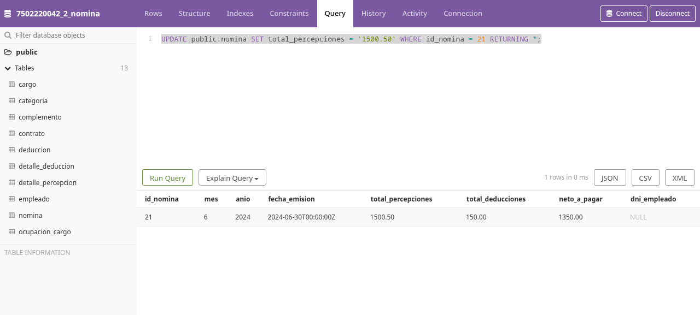

### Ejercicio 25. Mostrar el contenido completo de TablaX

**A. Instrucción SQL:**

```sql
SELECT * FROM public.nomina ORDER BY id_nomina;
```

**B. Explicación:** Muestra el contenido completo después de la conversión.

**Resultado obtenido:** 21 filas; la fila 21 muestra `1500.50`.

**C. Captura:** 

### Ejercicio 26. Elegir una columna de texto de TablaX y cambiar un registro ingresando un valor numérico sin comillas simples

**A. Instrucción SQL:**

```sql
UPDATE public.nomina SET dni_empleado = 123 WHERE id_nomina = 21;
```

**B. Explicación:** Intenta asignar un número sin comillas a una columna de texto. En PostgreSQL el entero se convierte a texto, pero el valor `'123'` no existe en `empleado.dni`, así que la FK lo rechaza.

**Resultado obtenido:** ERROR: `insert or update on table "nomina" violates foreign key constraint "fk_nomina_empleado"`. **No hubo error de tipo**: la coerción entero→texto ocurrió y el rechazo fue por la FK.

**C. Captura:** 

### Ejercicio 27. Mostrar el contenido completo de TablaX

**A. Instrucción SQL:**

```sql
SELECT * FROM public.nomina ORDER BY id_nomina;
```

**B. Explicación:** Muestra el contenido completo; el intento del 26 no modificó datos.

**Resultado obtenido:** 21 filas; la fila 21 conserva `1500.50`.

**C. Captura:** 

### Ejercicio 28. Elegir una columna de fecha de TablaX, seleccionar al menos un registro e insertar en forma completa un registro con fecha `29-02-2023`

**A. Instrucción SQL:**

```sql
INSERT INTO public.nomina
    (id_nomina, mes, anio, fecha_emision,
     total_percepciones, total_deducciones,
     neto_a_pagar, dni_empleado)
VALUES
    (36, 2, 2023, '29-02-2023',
     2000.00, 200.00, 1800.00, NULL);
```

**B. Explicación:** inserta una fila completa con la fecha `29-02-2023`. El 2023 no es bisiesto, así que la fecha no existe.

**Resultado obtenido:** ERROR: `date/time field value out of range: "29-02-2023"`. No se insertó ninguna fila.

**C. Captura:** 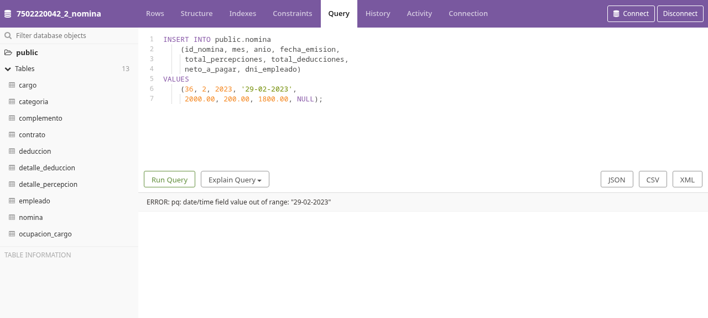

### Ejercicio 29. Mostrar el contenido completo de TablaX

**A. Instrucción SQL:**

```sql
SELECT * FROM public.nomina ORDER BY id_nomina;
```

**B. Explicación:** muestra el contenido completo tras el intento fallido del 28; debe seguir en 21 filas.

**Resultado obtenido:** 21 filas.

**C. Captura:** 

### Ejercicio 30. Repetir la operación practicando con las siguientes fechas y mostrando el resultado

**A. Instrucciones SQL (una por fecha, con el id que consumió la secuencia):**

```sql
-- 30a
INSERT INTO public.nomina
    (id_nomina, mes, anio, fecha_emision,
     total_percepciones, total_deducciones,
     neto_a_pagar, dni_empleado)
VALUES
    (37, 2, 2023, '23-12-10', 2000.00, 200.00, 1800.00, NULL)
RETURNING *;

-- 30b
INSERT INTO public.nomina
    (id_nomina, mes, anio, fecha_emision,
     total_percepciones, total_deducciones,
     neto_a_pagar, dni_empleado)
VALUES
    (38, 2, 2023, '01/14/2023', 2000.00, 200.00, 1800.00, NULL)
RETURNING *;

-- 30c
INSERT INTO public.nomina
    (id_nomina, mes, anio, fecha_emision,
     total_percepciones, total_deducciones,
     neto_a_pagar, dni_empleado)
VALUES
    (39, 2, 2023, '-10/08/2023', 2000.00, 200.00, 1800.00, NULL)
RETURNING *;

-- 30d
INSERT INTO public.nomina
    (id_nomina, mes, anio, fecha_emision,
     total_percepciones, total_deducciones,
     neto_a_pagar, dni_empleado)
VALUES
    (40, 2, 2023, '12/30-2023', 2000.00, 200.00, 1800.00, NULL)
RETURNING *;

-- 30e
INSERT INTO public.nomina
    (id_nomina, mes, anio, fecha_emision,
     total_percepciones, total_deducciones,
     neto_a_pagar, dni_empleado)
VALUES
    (41, 2, 2023, '12-30-2023', 2000.00, 200.00, 1800.00, NULL)
RETURNING *;

-- 30f
INSERT INTO public.nomina
    (id_nomina, mes, anio, fecha_emision,
     total_percepciones, total_deducciones,
     neto_a_pagar, dni_empleado)
VALUES
    (42, 2, 2023, '2023-50-20', 2000.00, 200.00, 1800.00, NULL)
RETURNING *;

-- 30g
INSERT INTO public.nomina
    (id_nomina, mes, anio, fecha_emision,
     total_percepciones, total_deducciones,
     neto_a_pagar, dni_empleado)
VALUES
    (43, 2, 2023, '2023-06-21', 2000.00, 200.00, 1800.00, NULL)
RETURNING *;
```

**B. Explicación:** repite la inserción con cada uno de los siete formatos. No se agrupan en una sola sentencia porque un formato inválido abortaría la sentencia completa y no se podría registrar el resultado de cada fecha; por eso se prueban uno por uno.

**Resultado obtenido:**

| Intento | Fecha | Resultado |
|---|---|---|
| a | `23-12-10` | ERROR `date/time field value out of range` |
| b | `01/14/2023` | Aceptada → `2023-01-14` (id 38) |
| c | `-10/08/2023` | ERROR `invalid input syntax for type date` |
| d | `12/30-2023` | ERROR `invalid input syntax for type date` |
| e | `12-30-2023` | Aceptada → `2023-12-30` (id 41) |
| f | `2023-50-20` | ERROR `date/time field value out of range` |
| g | `2023-06-21` | Aceptada → `2023-06-21` (id 43) |

Con `DateStyle = ISO, MDY` se aceptan `MM/DD/YYYY` y `MM-DD-YYYY`; las fechas imposibles dan error de rango y los separadores mezclados, error de sintaxis.

**C. Capturas:**      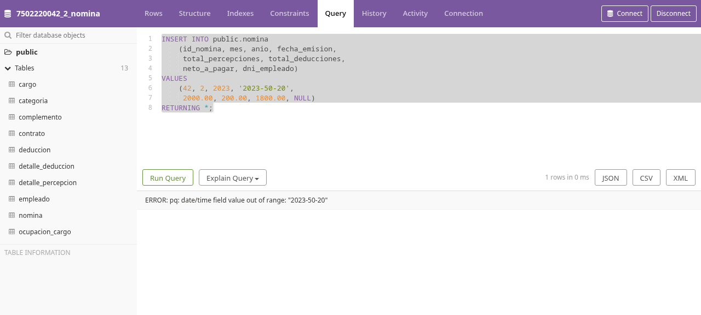 

### Ejercicio 31. Mostrar el contenido completo de TablaX

**A. Instrucción SQL:**

```sql
SELECT * FROM public.nomina ORDER BY id_nomina;
```

**B. Explicación:** muestra el contenido completo después de las tres fechas aceptadas.

**Resultado obtenido:** 24 filas: las 21 anteriores más ids 38, 41 y 43.

**C. Captura:** 

### Ejercicio 32. Cambiar en TablaX los valores actuales de columna1 y columna2 por otros diferentes solo en registros cuya PK sea igual a un dato específico x

**A. Instrucción SQL:**

```sql
UPDATE public.nomina SET total_percepciones=1600.00, total_deducciones=160.00 WHERE id_nomina=21 RETURNING *;
```

**B. Explicación:** Actualiza las dos columnas solo en la PK 21.

**Resultado obtenido:** 1 fila; id 21 queda en 1600.00 / 160.00.

**C. Captura:** 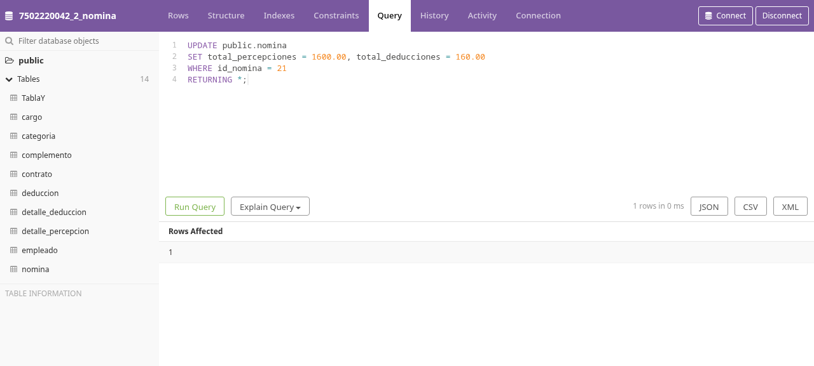

### Ejercicio 33. Mostrar el contenido completo de TablaX

**A. Instrucción SQL:**

```sql
SELECT * FROM public.nomina ORDER BY id_nomina;
```

**B. Explicación:** Muestra el contenido completo tras el cambio.

**Resultado obtenido:** 24 filas.

**C. Captura:** 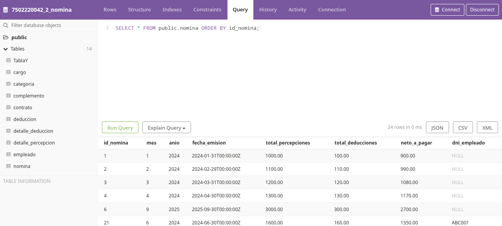

### Ejercicio 34. Cambiar columna1 y columna2 en TablaX solo para registros cuya PK sea igual a alguno de A, B, C, D, E

**A. Instrucción SQL:**

```sql
UPDATE public.nomina SET total_percepciones=1700.00, total_deducciones=170.00 WHERE id_nomina IN (21,22,23,24,25) RETURNING *;
```

**B. Explicación:** Actualiza solo las PK A–E (21–25).

**Resultado obtenido:** 5 filas; las cinco quedan en 1700.00 / 170.00.

**C. Captura:** 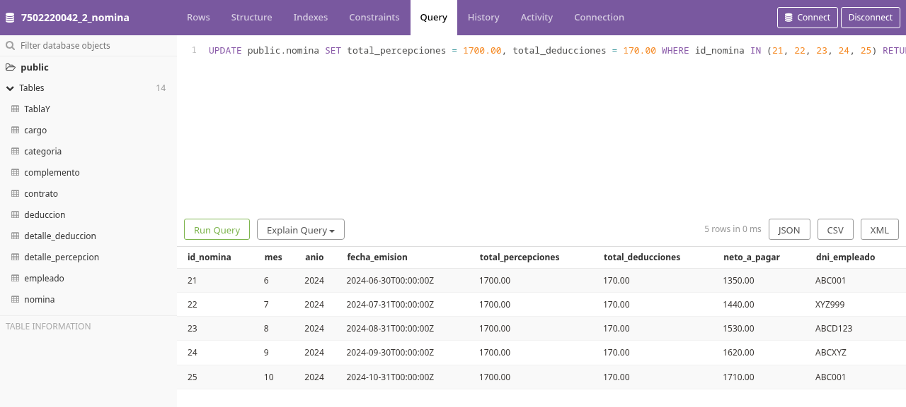

### Ejercicio 35. Mostrar el contenido completo de TablaX

**A. Instrucción SQL:**

```sql
SELECT * FROM public.nomina ORDER BY id_nomina;
```

**B. Explicación:** Muestra el contenido completo.

**Resultado obtenido:** 24 filas.

**C. Captura:** 

### Ejercicio 36. Cambiar columna1 y columna2 en TablaX solo para registros cuya PK sea igual a X o Y

**A. Instrucción SQL:**

```sql
UPDATE public.nomina SET total_percepciones=1800.00, total_deducciones=180.00 WHERE id_nomina IN (21,22) RETURNING *;
```

**B. Explicación:** Actualiza solo X o Y (21 y 22).

**Resultado obtenido:** 2 filas; 21 y 22 en 1800.00 / 180.00.

**C. Captura:** 

### Ejercicio 37. Mostrar el contenido completo de TablaX

**A. Instrucción SQL:**

```sql
SELECT * FROM public.nomina ORDER BY id_nomina;
```

**B. Explicación:** Muestra el contenido completo.

**Resultado obtenido:** 24 filas.

**C. Captura:** 

### Ejercicio 38. Cambiar columna1 y columna2 en TablaX solo para registros cuya PK sea igual a A y B

**A. Instrucción SQL:**

```sql
UPDATE public.nomina SET total_percepciones=1900.00, total_deducciones=190.00 WHERE id_nomina IN (21,22) RETURNING *;
```

**B. Explicación:** «A y B» se interpreta como ambos registros; se actualizan 21 y 22.

**Resultado obtenido:** 2 filas; 21 y 22 en 1900.00 / 190.00.

**C. Captura:** 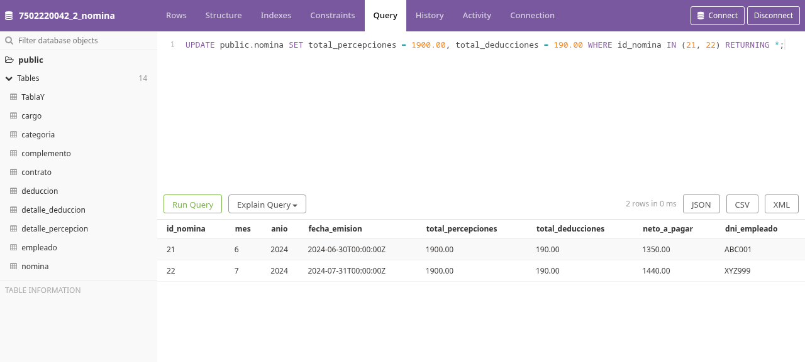

### Ejercicio 39. Mostrar el contenido completo de TablaX

**A. Instrucción SQL:**

```sql
SELECT * FROM public.nomina ORDER BY id_nomina;
```

**B. Explicación:** Muestra el contenido completo.

**Resultado obtenido:** 24 filas.

**C. Captura:** 

### Preparación de datos de prueba (ejercicios 40–56)

Los ejercicios 40 a 56 filtran por la columna `dni_empleado`, así que antes de ejecutarlos se cargaron cuatro empleados y se ligaron las nóminas 21–25 a esos DNI. Son **datos de prueba**, no información de personas reales.

```sql
INSERT INTO public.empleado
    (dni, nombres, apellidos, telefono, direccion,
     fecha_nacimiento, num_cuenta_corriente)
VALUES
    ('ABC001', 'Ana',     'Becerra', '3001112233', 'Calle 1 #2-03', DATE '1990-01-15', '0011223344'),
    ('ABCD123','Alberto', 'Cadena',  '3003334455', 'Calle 3 #4-05', DATE '1992-03-25', '0033445566'),
    ('ABCXYZ', 'Andres',  'Cruz',    '3004445566', 'Calle 4 #5-06', DATE '1993-04-30', '0044556677'),
    ('XYZ999', 'Ximena',  'Yepes',   '3002223344', 'Calle 2 #3-04', DATE '1991-02-20', '0022334455');
```

```sql
UPDATE public.nomina SET dni_empleado = 'ABC001'  WHERE id_nomina = 21 RETURNING *;
UPDATE public.nomina SET dni_empleado = 'XYZ999'  WHERE id_nomina = 22 RETURNING *;
UPDATE public.nomina SET dni_empleado = 'ABCD123' WHERE id_nomina = 23 RETURNING *;
UPDATE public.nomina SET dni_empleado = 'ABCXYZ'  WHERE id_nomina = 24 RETURNING *;
UPDATE public.nomina SET dni_empleado = 'ABC001'  WHERE id_nomina = 25 RETURNING *;
```

El orden importa: primero el padre (`empleado`) y después la FK de `nomina`; al revés, la FK rechazaría los DNI. Con esto quedan cinco nóminas con DNI (21 y 25 con `ABC001`, 22 con `XYZ999`, 23 con `ABCD123`, 24 con `ABCXYZ`) y diecinueve con NULL, que es lo que explican los conteos de los ejercicios 40–57.

### Ejercicio 40. Cambiar columna1 y columna2 en TablaX solo en registros cuyo valor de columnaX esté entre A y Z

**A. Instrucción SQL:**

```sql
UPDATE public.nomina SET total_percepciones=2000.00, total_deducciones=200.00 WHERE dni_empleado BETWEEN 'ABC001' AND 'ABCXYZ' RETURNING *;
```

**B. Explicación:** Filtra por columnaX (dni) en el intervalo A–Z.

**Resultado obtenido:** 4 filas: 21, 23, 24 y 25. `XYZ999` queda fuera por orden alfabético.

**C. Captura:** 

### Ejercicio 41. Mostrar el contenido completo de TablaX

**A. Instrucción SQL:**

```sql
SELECT * FROM public.nomina ORDER BY id_nomina;
```

**B. Explicación:** Muestra el contenido completo.

**Resultado obtenido:** 24 filas.

**C. Captura:** 

### Ejercicio 42. Cambiar columna1 y columna2 en TablaX solo en registros cuyo valor en columna3 sea mayor o igual a X

**A. Instrucción SQL:**

```sql
UPDATE public.nomina SET total_percepciones=2100.00, total_deducciones=210.00 WHERE neto_a_pagar >= 1500.00 RETURNING *;
```

**B. Explicación:** Filtra por columna3 (neto) mayor o igual a 1500.

**Resultado obtenido:** 17 filas.

**C. Captura:** 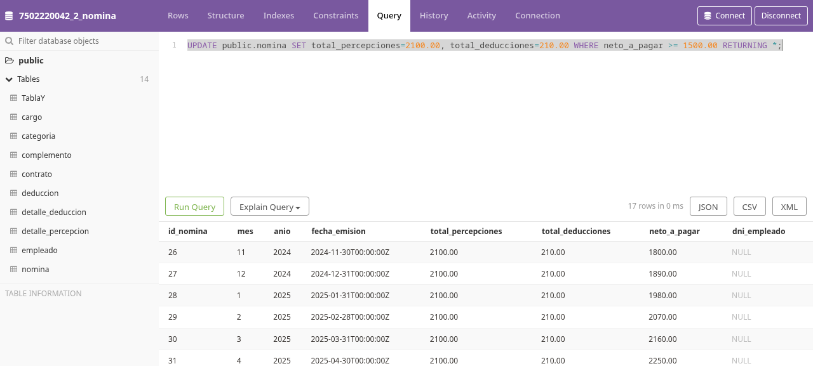

### Ejercicio 43. Mostrar el contenido completo de TablaX

**A. Instrucción SQL:**

```sql
SELECT * FROM public.nomina ORDER BY id_nomina;
```

**B. Explicación:** Muestra el contenido completo.

**Resultado obtenido:** 24 filas.

**C. Captura:** 

### Ejercicio 44. Cambiar columna1 y columna2 en TablaX solo en registros cuyo valor en columna3 “esté entre diferente a X dato”

**A. Instrucción SQL:**

```sql
UPDATE public.nomina SET total_percepciones=2200.00, total_deducciones=220.00 WHERE neto_a_pagar <> 1350.00 RETURNING *;
```

**B. Explicación:** La frase «entre diferente a X» se interpreta como `<>`; X = 1350.

**Resultado obtenido:** 23 filas; solo excluye la 21.

**C. Captura:** 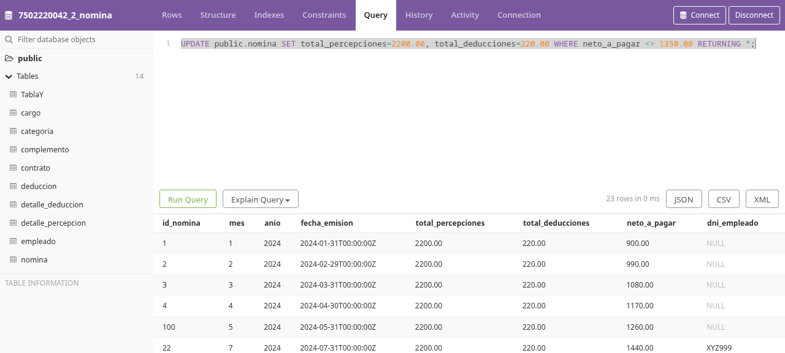

### Ejercicio 45. Mostrar el contenido completo de TablaX

**A. Instrucción SQL:**

```sql
SELECT * FROM public.nomina ORDER BY id_nomina;
```

**B. Explicación:** Muestra el contenido completo.

**Resultado obtenido:** 24 filas.

**C. Captura:** 

### Ejercicio 46. Cambiar columna1 y columna2 en TablaX solo en registros cuyo valor de columnaX esté entre A y Z

**A. Instrucción SQL:**

```sql
UPDATE public.nomina SET total_percepciones=2300.00, total_deducciones=230.00 WHERE dni_empleado BETWEEN 'ABC001' AND 'ABCXYZ' RETURNING *;
```

**B. Explicación:** Repite el intervalo A–Z sobre columnaX.

**Resultado obtenido:** 4 filas.

**C. Captura:** 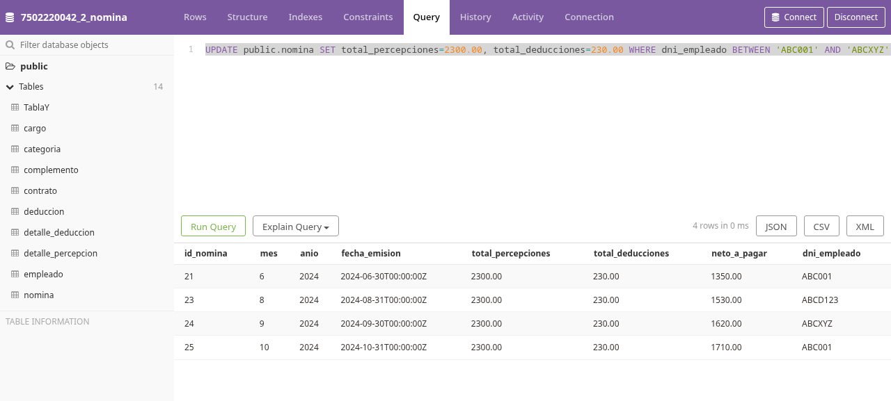

### Ejercicio 47. Mostrar el contenido completo de TablaX

**A. Instrucción SQL:**

```sql
SELECT * FROM public.nomina ORDER BY id_nomina;
```

**B. Explicación:** Muestra el contenido completo.

**Resultado obtenido:** 24 filas.

**C. Captura:** 

### Ejercicio 48. Cambiar columna1 y columna2 en TablaX solo en registros cuyo valor en columnaX inicie con ABC

**A. Instrucción SQL:**

```sql
UPDATE public.nomina SET total_percepciones=2400.00, total_deducciones=240.00 WHERE dni_empleado LIKE 'ABC%' RETURNING *;
```

**B. Explicación:** Filtra los valores que inician con ABC.

**Resultado obtenido:** 4 filas: 21, 23, 24 y 25.

**C. Captura:** 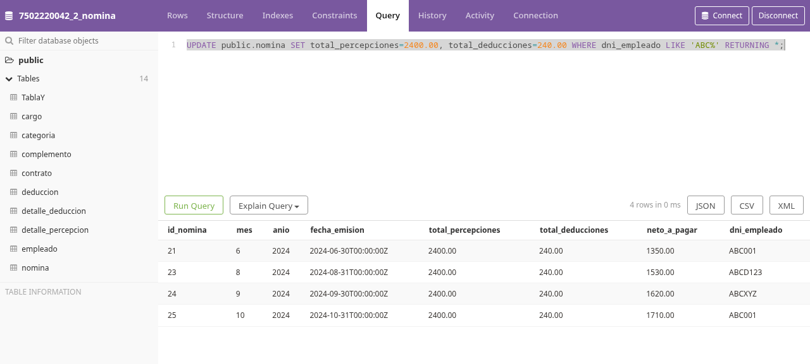

### Ejercicio 49. Mostrar el contenido completo de TablaX

**A. Instrucción SQL:**

```sql
SELECT * FROM public.nomina ORDER BY id_nomina;
```

**B. Explicación:** Muestra el contenido completo.

**Resultado obtenido:** 24 filas.

**C. Captura:** 

### Ejercicio 50. Cambiar columna1 y columna2 en TablaX solo en registros cuyo valor en columnaX termine con XYZ

**A. Instrucción SQL:**

```sql
UPDATE public.nomina SET total_percepciones=2500.00, total_deducciones=250.00 WHERE dni_empleado LIKE '%XYZ' RETURNING *;
```

**B. Explicación:** Filtra los valores que terminan en XYZ.

**Resultado obtenido:** 1 fila: 24 (ABCXYZ).

**C. Captura:** 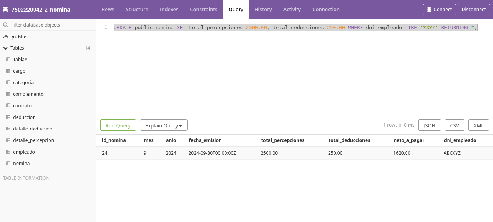

### Ejercicio 51. Mostrar el contenido completo de TablaX

**A. Instrucción SQL:**

```sql
SELECT * FROM public.nomina ORDER BY id_nomina;
```

**B. Explicación:** Muestra el contenido completo.

**Resultado obtenido:** 24 filas.

**C. Captura:** 

**Nota de evidencia:** la fila modificada por el ejercicio 52 se ve en su captura, donde el `UPDATE` usa `RETURNING *`. El `SELECT` de esta captura puede no reflejar el cambio si el cliente conserva en pantalla un resultado anterior.

### Ejercicio 52. Cambiar columna1 y columna2 en TablaX solo en registros cuyo valor en columnaX contenga ABCD

**A. Instrucción SQL:**

```sql
UPDATE public.nomina SET total_percepciones=2600.00, total_deducciones=260.00 WHERE dni_empleado LIKE '%ABCD%' RETURNING *;
```

**B. Explicación:** Filtra los valores que contienen ABCD.

**Resultado obtenido:** 1 fila: 23 (ABCD123).

**C. Captura:** 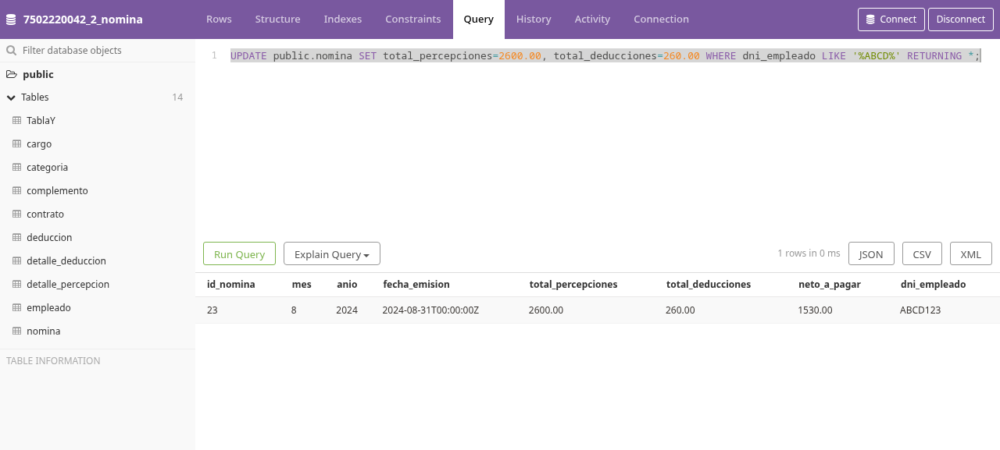

### Ejercicio 53. Mostrar el contenido completo de TablaX

**A. Instrucción SQL:**

```sql
SELECT * FROM public.nomina ORDER BY id_nomina;
```

**B. Explicación:** Muestra el contenido completo.

**Resultado obtenido:** 24 filas.

**C. Captura:** 

**Nota:** el `UPDATE` del ejercicio 52 muestra la fila modificada con `RETURNING *`; esta captura es un `SELECT` y puede no reflejar el cambio.

### Ejercicio 54. Cambiar columna1 y columna2 en TablaX solo en registros cuyo valor en columnaX sea igual a NULL

**A. Instrucción SQL:**

```sql
UPDATE public.nomina SET total_percepciones=2700.00, total_deducciones=270.00 WHERE dni_empleado IS NULL RETURNING *;
```

**B. Explicación:** «Igual a NULL» se implementa con `IS NULL`; comparar con `=` nunca es verdadero.

**Resultado obtenido:** 19 filas con dni NULL.

**C. Captura:** 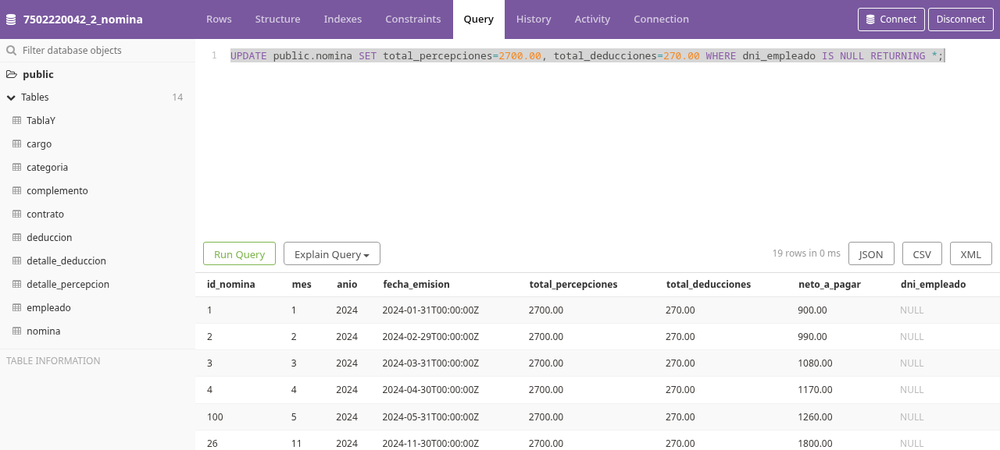

### Ejercicio 55. Mostrar el contenido completo de TablaX

**A. Instrucción SQL:**

```sql
SELECT * FROM public.nomina ORDER BY id_nomina;
```

**B. Explicación:** Muestra el contenido completo.

**Resultado obtenido:** 24 filas.

**C. Captura:** 

### Ejercicio 56. Cambiar columna1 y columna2 en TablaX solo en registros cuyo valor en columnaX sea diferente a NULL

**A. Instrucción SQL:**

```sql
UPDATE public.nomina SET total_percepciones=2800.00, total_deducciones=280.00 WHERE dni_empleado IS NOT NULL RETURNING *;
```

**B. Explicación:** «Diferente a NULL» se implementa con `IS NOT NULL`.

**Resultado obtenido:** 5 filas: 21–25.

**C. Captura:** 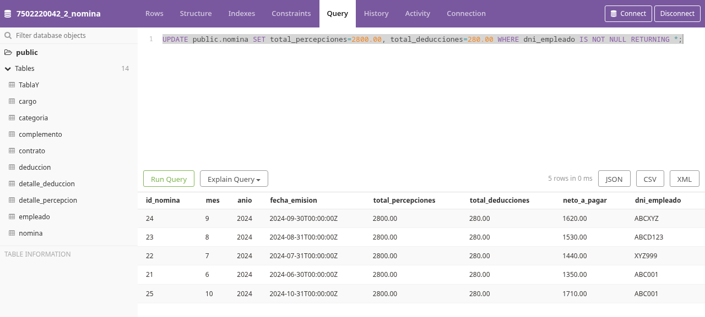

### Ejercicio 57. Mostrar el contenido completo de TablaX

**A. Instrucción SQL:**

```sql
SELECT * FROM public.nomina ORDER BY id_nomina;
```

**B. Explicación:** Muestra el contenido completo.

**Resultado obtenido:** 24 filas; 21–25 en 2800.00 / 280.00 y las 19 con dni NULL en 2700.00 / 270.00.

**C. Captura:** 

### Ejercicio 58. En `bd_ejercicio_xyz`, crear una tabla nueva llamada TablaY con el esquema y tipos descritos

**A. Instrucción SQL:**

```sql
CREATE TABLE public."TablaY" (
  id serial PRIMARY KEY,
  fecha timestamp NOT NULL,
  nombre varchar(60),
  apellidos varchar(60),
  asignatura varchar(80),
  mensaje text,
  nota1 numeric(5,2),
  nota2 numeric(5,2),
  nota3 numeric(5,2),
  definitiva numeric(6,3),
  promedio numeric(6,3)
);
```

**B. Explicación:** `bd_ejercicio_xyz` es el marcador genérico de la guía; la base real de trabajo es `7502220042_2_nomina`, donde se creó la tabla. `id` es autoincremental; `fecha` es fecha-hora; los textos usan `varchar`/`text`; las notas y cálculos son decimales. `definitiva` y `promedio` se declaran con 3 decimales para que coincidan con los ejemplos del documento.

**Resultado obtenido:** tabla creada con 11 columnas.

**Nota sobre la precisión:** la captura 58 muestra `numeric(5,2)` porque la tabla se creó así en ese momento. Después se amplió la precisión de las columnas calculadas a `numeric(6,3)` para que `0.333` y `0.666` coincidan con el documento; el SQL de este informe muestra la versión final, no la de la captura.

**C. Captura:** 

### Ejercicio 59. Mostrar el contenido completo de TablaY

**A. Instrucción SQL:**

```sql
SELECT * FROM public."TablaY" ORDER BY id;
```

**B. Explicación:** muestra la tabla recién creada; debe estar vacía.

**Resultado obtenido:** 0 filas.

**C. Captura:** 

### Ejercicio 60. Insertar en TablaY cada registro de la tabla de datos para que quede exactamente con esos datos

**A. Instrucción SQL:**

```sql
INSERT INTO public."TablaY"
    (fecha, nombre, apellidos, asignatura, mensaje, nota1, nota2, nota3)
VALUES
    ('2023-05-20 00:00:00','Persona 1','De tal','Estructuras de datos','Prácticamente no hizo nada',1,NULL,NULL),
    ('2023-06-20 00:00:00','Persona 1','De tal','Estructuras de datos','La actividad es una copia de fragmentos disponibles en internet',1,1,NULL),
    ('2023-07-20 00:00:00','Persona 1','De tal','Estructuras de datos','La actividad esta completa pero no pudo sustentar, explicarla y no domina el desarrollo de ninguno de los ejercicios',1,1,1),
    ('2023-05-20 00:00:00','Persona 3','De tal','Estructuras de datos','Actividad al 80%, pero fue desarrollada progresivamente y socializada al docente en cada tutoria',4,NULL,NULL),
    ('2023-06-20 00:00:00','Persona 3','De tal','Estructuras de datos','Actividad completa y entregada una semana antes del cierre, con video y sin documento',4,4.5,NULL),
    ('2023-07-20 00:00:00','Persona 3','De tal','Estructuras de datos','Actividad entregada mucho antes del cierre, 100% completa, con documento, video y sustentación',4,4.5,5)
RETURNING *;
```

**B. Explicación:** inserta los seis registros de la tabla de datos. Se omiten `id`, `definitiva` y `promedio`; el primero lo asigna la secuencia y los otros quedan NULL hasta el ejercicio 62.

**Resultado obtenido:** 6 filas, ids 1–6.

**C. Captura:** 

### Ejercicio 61. Mostrar el contenido completo de TablaY

**A. Instrucción SQL:**

```sql
SELECT * FROM public."TablaY" ORDER BY id;
```

**B. Explicación:** muestra los seis registros insertados.

**Resultado obtenido:** 6 filas.

**C. Captura:** 

### Ejercicio 62. Actualizar automáticamente los cálculos correctos de definitiva y promedio en cada registro de TablaY

**A. Instrucción SQL:**

```sql
UPDATE public."TablaY" SET
  definitiva = trunc(coalesce(nota1,0)*0.20 + coalesce(nota2,0)*0.20 + coalesce(nota3,0)*0.60, 3),
  promedio  = trunc((coalesce(nota1,0)+coalesce(nota2,0)+coalesce(nota3,0))/3.0, 3)
RETURNING *;
```

**B. Explicación:** calcula `definitiva` con pesos 20 %, 20 % y 60 %, y `promedio` como la media de las tres notas. Los NULL se tratan como 0, que es lo que reflejan los ejemplos del documento (`1,NULL,NULL → 0.2 / 0.333`).

**Resultado obtenido:** 6 filas. Valores: 0.200/0.333, 0.400/0.666, 1.000/1.000, 0.800/1.333, 1.700/2.833, 4.700/4.500.

Los valores calculados se ven en la captura del ejercicio 63, que muestra la tabla ya actualizada; el `RETURNING *` del 62 no se despliega en el cliente.

**C. Captura:** 

### Ejercicio 63. Mostrar el contenido completo de TablaY

**A. Instrucción SQL:**

```sql
SELECT * FROM public."TablaY" ORDER BY id;
```

**B. Explicación:** comprueba los cálculos del ejercicio 62.

**Resultado obtenido:** 6 filas con `definitiva` y `promedio` calculados.

**C. Captura:** 

### Ejercicio 64. Modificar todas las columnas de tipo carácter de TablaY para que queden en mayúscula sostenida

**A. Instrucción SQL:**

```sql
UPDATE public."TablaY" SET
  nombre = upper(nombre),
  apellidos = upper(apellidos),
  asignatura = upper(asignatura),
  mensaje = upper(mensaje)
RETURNING *;
```

**B. Explicación:** convierte a mayúscula sostenida las cuatro columnas de texto.

**Resultado obtenido:** 6 filas; se conservan los acentos (`PRÁCTICAMENTE`, `SUSTENTACIÓN`).

**C. Captura:** 

### Ejercicio 65. Mostrar el contenido completo de TablaY

**A. Instrucción SQL:**

```sql
SELECT * FROM public."TablaY" ORDER BY id;
```

**B. Explicación:** muestra el contenido final con los textos en mayúscula.

**Resultado obtenido:** 6 filas.

**C. Captura:** 

### Ejercicio 66. Eliminar solo un registro de TablaX cuyos datos tengan PK igual al valor Y

**A. Instrucción SQL:**

```sql
DELETE FROM public.nomina WHERE id_nomina = 100 RETURNING *;
```

**B. Explicación:** Elimina solo la nómina 100. El detalle 6 la referencia y se borra en cascada por `ON DELETE CASCADE`.

**Resultado obtenido:** 1 nómina borrada; quedan 23 nóminas y 5 detalles.

**C. Captura:** 

### Ejercicio 67. Mostrar el contenido completo de TablaX

**A. Instrucción SQL:**

```sql
SELECT * FROM public.nomina ORDER BY id_nomina;
```

**B. Explicación:** Muestra el contenido completo después del borrado; ya no aparece la 100.

**Resultado obtenido:** 23 filas.

**C. Captura:** 

### Ejercicio 68. Eliminar todos los registros de TablaX

**A. Instrucción SQL:**

```sql
DELETE FROM public.nomina;
```

**B. Explicación:** Elimina todas las nóminas. La cascada borra los detalles restantes. No se usa `TRUNCATE` ni `DROP`.

**Resultado obtenido:** 23 filas borradas; 0 nóminas y 0 detalles.

**C. Captura:** 

### Ejercicio 69. Mostrar el contenido completo de TablaY

**A. Instrucción SQL:**

```sql
SELECT * FROM public."TablaY" ORDER BY id;
```

**B. Explicación:** Muestra `TablaY`, que no depende de `nomina` y conserva sus 6 filas.

**Resultado obtenido:** 6 filas en mayúscula.

**C. Captura:** 

**Nota de cierre de la serie:** después de tomar las capturas se restauraron los datos de la copia de prueba. La base quedó con 24 nóminas, 6 detalles de percepción, `TablaY` con 6 filas y 4 empleados de prueba.

## Conclusión

La actividad recorrió las tres operaciones DML sobre una copia restaurada de la base NOMINA. Los INSERT mostraron las formas completa, parcial y múltiple, y los rechazos por PK duplicada, FK inexistente, NOT NULL, tipo y fecha inválida. Los UPDATE permitieron comprobar filtros por PK, por rangos, por texto (`BETWEEN`, `LIKE`) y por NULL, además de la conversión de tipos y el efecto de `ON UPDATE CASCADE`. Los DELETE evidenciaron el borrado de una fila con cascada y el borrado masivo. Las capturas, la restauración posterior y las verificaciones de catálogo dejan el estado de la copia de prueba documentado y reproducible.

